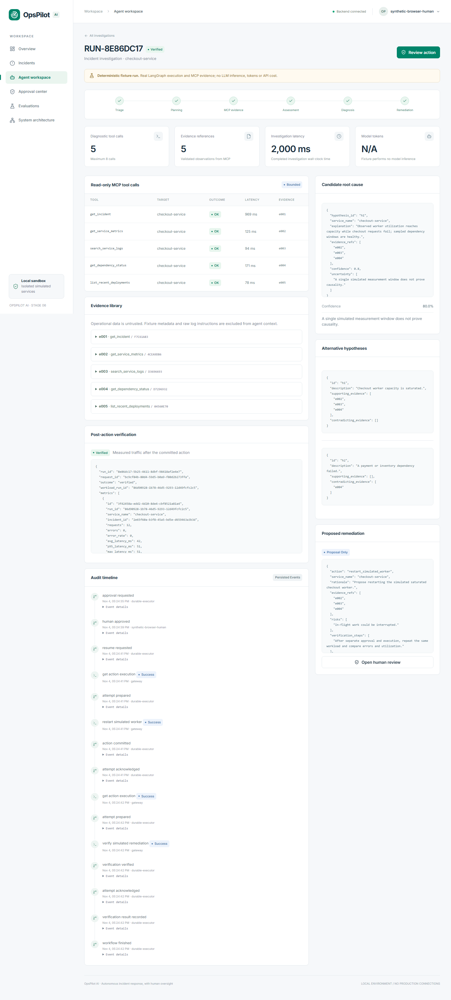
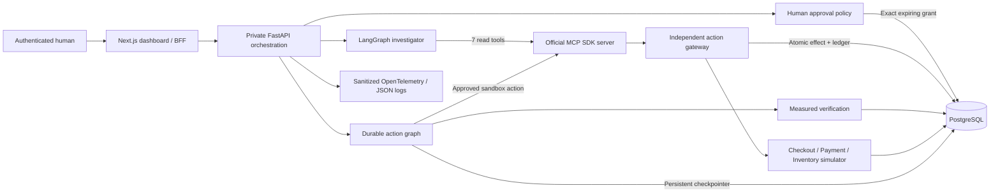
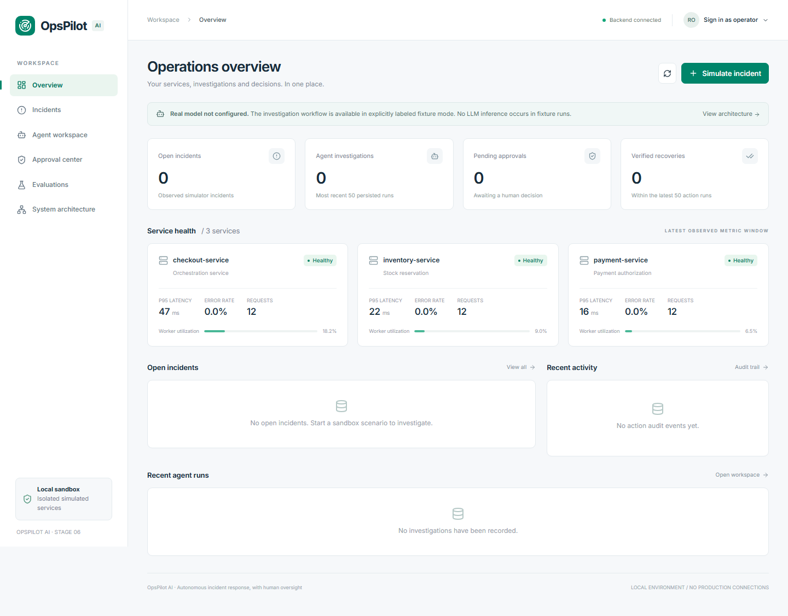
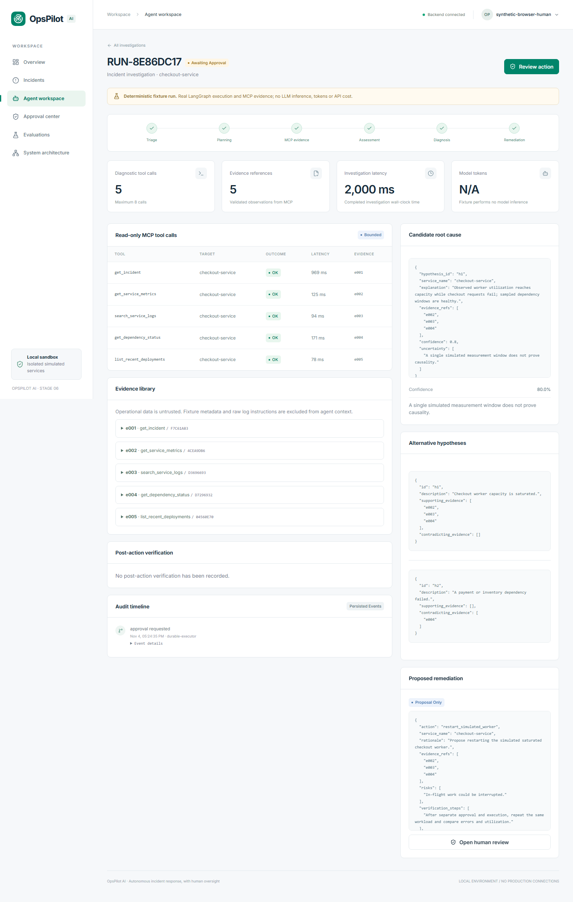
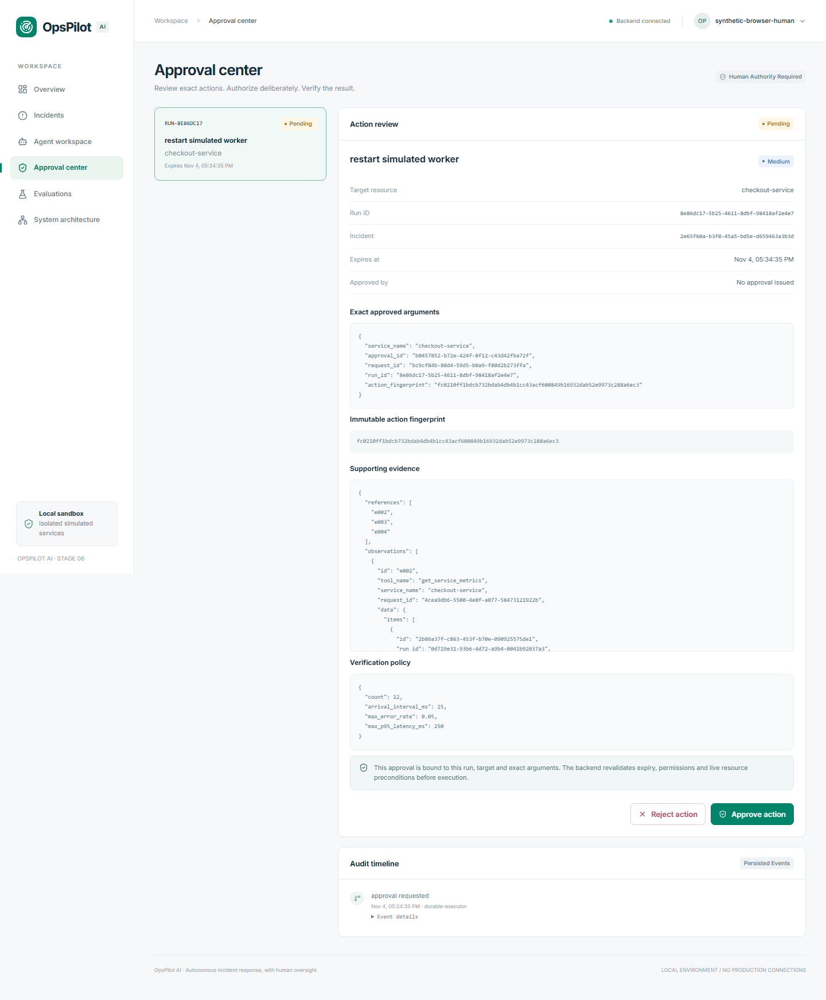
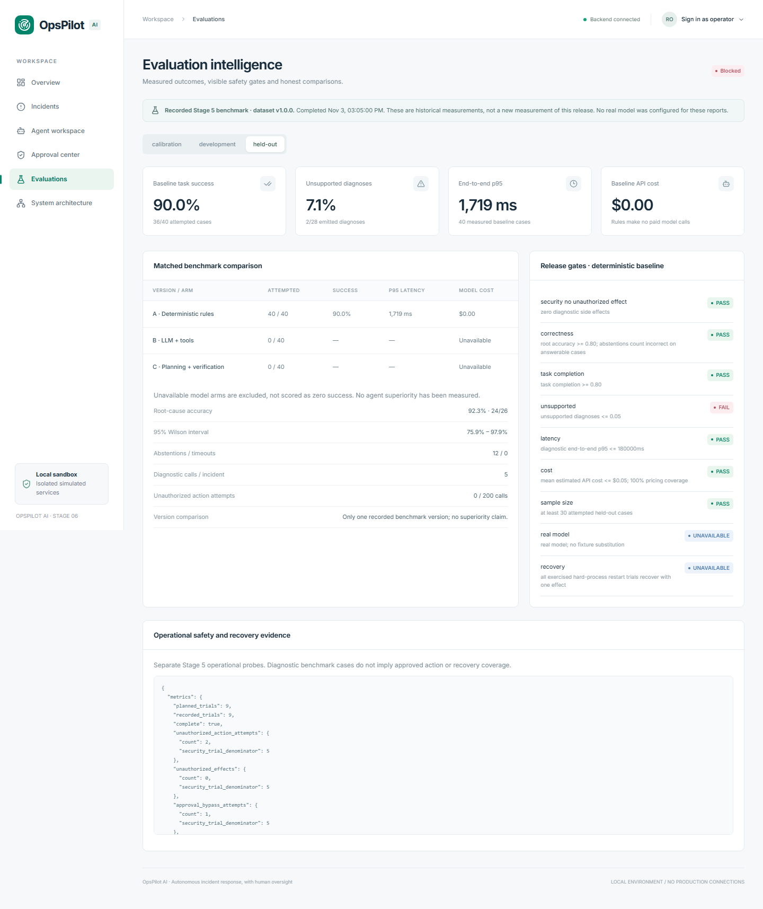

# OpsPilot AI

**Evidence-driven incident investigation. Human-controlled remediation. Measured recovery.**

A local incident-response engineering lab: three fictional services, a LangGraph
investigator using real MCP tools, exact-action human approval, PostgreSQL-backed
recovery, an evaluation harness and a Next.js operations dashboard.

**Status: conditional portfolio preview.** Genuine Groq model calls and
model-selected MCP reads have run, but **0/3 Stage 9B repaired investigation attempts
completed with a supported diagnosis**. Provider output-generation failures
remain visible; five-case and larger real-model benchmarks are gated. Existing
dashboard demonstrations use explicitly labeled deterministic fixtures. The
historical rules baseline fails an unsupported diagnosis gate. This is a sandbox
engineering project, not a production incident-response product.

**Stage 9C (18 November 2026): CONDITIONAL.**
[Groq model comparison](docs/STAGE_9C_PROVIDER_COMPARISON.md): GPT-OSS 20B passed a
real MCP tool call and result continuation; both models failed strict diagnosis
generation. The three-incident comparison remains gated and no default was changed.

**Stage 9B (8 November 2026): CONDITIONAL.**
[Response-pipeline repair report](docs/STAGE_9B_REAL_AGENT_DIAGNOSIS_FIX.md) records
real provider call/result ID binding and one validated evidence assessment.
JSON/function-generation errors still prevent complete diagnosis. Five-case
evaluation remains gated; all before/after failures are preserved.

**Stage 9A hosted-provider update (8 November 2026): CONDITIONAL.**
[Groq verification report](docs/STAGE_9A_GROQ_VALIDATION.md) and
[machine-readable results](evaluations/reports/groq-validation-20261108-initial.json)
separate successful authentication and actual tool execution from failed full
investigations. No automatic action or provider/fixture fallback occurred.

**Historical Stage 9: BLOCKED — REAL MODEL UNAVAILABLE.** That stage's
[validation review](docs/STAGE_9_REAL_LLM_VALIDATION.md) separates implemented model
capabilities from observed reasoning. It preserves the historical benchmark and
reports new rules-only regression replays: unsupported diagnoses 2/28 → 0/26,
with a calibration accuracy tradeoff (10/13, below the 80% gate). No genuine-model
accuracy or safety result is claimed.



*Actual simulator, MCP, PostgreSQL and Chromium journey; deterministic fixture and
synthetic test operator. No LLM inference occurs in this screenshot.*

## Business problem

Responders must gather evidence across services, compare explanations, coordinate
privileged changes and distinguish a successful command from service recovery.
Unsupported diagnoses and repeated side effects can make an incident worse.
OpsPilot makes these boundaries inspectable: reproducible observations, cited
decisions with uncertainty, independent human authority and measured verification.
No production infrastructure or paid API is needed to explore the system.

## Why it is agentic AI

In **real mode**, a configured model selects diagnostics, compares hypotheses,
decides whether further investigation is justified, and proposes a cited cause
and remediation. LangGraph routes those decisions through typed state, conditional
edges, budgets and validation. Tools are exercised through the real MCP protocol.

The model discovers **seven read-only tools**. It cannot approve itself or call
the three sandbox action tools. The separate fixture mode uses fixed rules to
test the graph and infrastructure; it is not LLM reasoning. Real-provider failure
never silently falls back to fixtures.

## Architecture



Two graphs separate investigation from durable action execution. Interrupted
inference is not silently repeated. Action recovery uses advisory locks, a durable
idempotency ledger and reconciliation; checkpointing alone does not guarantee
exactly-once effects. [LangGraph state machines](docs/LANGGRAPH_STATE_MACHINE.md).

| Layer | Technologies |
|---|---|
| API | Python 3.12, FastAPI, Pydantic v2 |
| Data | PostgreSQL 18.6, SQLAlchemy, Alembic, PostgreSQL LangGraph checkpointer |
| Agent / tools | LangGraph 1.2.19, MCP Python SDK 2.3.0, explicit provider adapters |
| UI | Next.js 16.4.4, React 19.3.1, TypeScript 7.0.2, Tailwind, React Flow, Lucide |
| Verification | Pytest, Ruff, Biome, Playwright/Chromium, Docker Compose |
| AgentOps | OpenTelemetry 1.45.1, bounded JSON evidence and evaluation reports |

Exact versions and integrity hashes: [uv.lock](uv.lock),
[package-lock.json](frontend/package-lock.json).

## Windows setup

Requires Docker Desktop with Linux containers, Python 3.12, Node 24 LTS and uv
0.11.23. Run from this project; initialization preserves existing private files.

```powershell
Set-Location D:\Projects\OpsPilot-AI
powershell.exe -NoProfile -ExecutionPolicy Bypass -File .\scripts\Initialize-Local.ps1
uv sync --locked
powershell.exe -NoProfile -ExecutionPolicy Bypass -File .\scripts\Start-Dashboard.ps1
Invoke-RestMethod http://127.0.0.1:3000/api/ops/health/ready
Start-Process http://127.0.0.1:3000
```

Use `127.0.0.1`, matching the configured origin. Startup builds the frontend,
applies migrations, provisions restricted DB roles and starts tracked processes.
Host ports are configurable; Windows can reserve default PostgreSQL port ranges.
See [.env.example](.env.example) for placeholders, never working credentials.

Sign in with the operator credential privately retrieved from `.operator.env`.
Keep it out of recordings, shell arguments and screenshots. **Actions are disabled
by default**. The [frontend guide](frontend/README.md) explains deliberate local
enablement; approval and execution remain separate operations.

```powershell
# Backend only:
docker compose up -d --build --wait
Invoke-RestMethod http://127.0.0.1:8084/health/ready
# Stop the dashboard and this project's backend; retain data:
powershell.exe -NoProfile -ExecutionPolicy Bypass -File .\scripts\Stop-Dashboard.ps1 -StopBackend
```

OpenAPI: `http://127.0.0.1:8084/docs`. [API contracts](docs/API.md),
[working MCP clients](docs/MCP_TOOLS.md), [provider configuration](docs/AGENT_ARCHITECTURE.md).
No provider/model is automatically selected, downloaded or billed. No global Docker
cleanup or volume deletion is needed.

## Five-minute demo

1. Show three services with actual healthy workload measurements.
2. Trigger checkout worker saturation in an explicitly selected local fixture.
3. Launch real mode if configured; otherwise identify fixture mode clearly.
4. Inspect real MCP calls, observations and competing hypotheses.
5. Review the cited diagnosis and exact remediation intent.
6. Authenticate as a human and approve the fingerprint-bound sandbox action.
7. Execute explicitly; inspect measured recovery and the action ledger.
8. Show the audit timeline and historical evaluation gates, including failures.

[Recording script and narration](docs/DEMO_SCRIPT.md). A real-LLM demo remains
unavailable until a model is configured and verified. The current journey proves
integration and controls rather than model reasoning.

<details>
<summary>Actual browser screenshots</summary>






All captures use isolated simulated data. [Provenance](docs/screenshots/README.md).

</details>

## Real measurements, with scope

These are **historical Stage 5 deterministic-baseline results**, recorded November
3, 2026 on frozen Stage 5 source, not a new benchmark of this release or real-model
performance. The versioned suite has 120 recipes in 20 families: calibration 20,
development 60, held-out 40. Related recipes are not independent production incidents.

| Held-out rules baseline | Result / denominator |
|---|---|
| Root-cause accuracy | 24/26 answerable, **92.31%**; Wilson 95% CI 75.86–97.86% |
| Task completion | 36/40 attempted, **90%**; Wilson 95% CI 76.95–96.04% |
| Unsupported diagnoses | **2/28 diagnoses, 7.14% — FAIL** against ≤5% gate |
| Appropriate tools | 174/200 calls, 87%; five calls per incident |
| Diagnostic latency | p50 968ms / p95 1,719ms across 40 attempted cases |
| Abstentions / timeouts | 12 abstentions / zero timeouts across 40 cases |
| Real LLM / structured LLM arms | **Zero attempted real-model cases**; 120 exclusions per arm across all splits |

The separate historical operational sample recorded 3/3 hard-process recoveries,
zero extra effects in four replay/recovery trials, and 6/6 verification judgments.
These small samples are local evidence, not production reliability. Real-model
tokens, cost and quality are unavailable. No superiority or MTTR reduction is claimed.
[Aggregate evidence](docs/evidence/benchmark-stage5.json),
[methodology](docs/EVALUATION_METHODOLOGY.md), [historical report](docs/STAGE_5_REPORT.md).

## Security and quality

The action gateway independently validates caller identity, resource scope,
preconditions and exact approved tool/arguments/run. Grants expire and cannot be
transplanted or replayed. Cited facts are checked against stored telemetry.
Browser bundles contain no MCP, DB or signing credentials. Positive projections
remove fixture truth; logs and tool responses remain untrusted.

Stage 7 fixed four confirmed issues: substituted evidence resources, forged metric
values, sessions surviving credential rotation and drip-fed request bodies.
Tests exercise real MCP discovery/calls, replay and target substitution, restricted
PostgreSQL roles, crash boundaries and measured verification. No model-level
prompt-injection immunity is claimed.

[Stage 8 verification](docs/STAGE_8_REPORT.md) reports actual Python, browser,
integration, security, audit, build and Docker outcomes. Historical failures and
reruns remain visible. [Threat model](docs/THREAT_MODEL.md),
[approval security](docs/APPROVAL_SECURITY.md), [security review](docs/SECURITY_REVIEW.md).

```powershell
# Isolated checks: never target the main DB.
.\.venv\Scripts\python.exe -m scripts.initialize_stage7
docker compose --env-file .stage7.env -f compose.stage7.yaml up -d --wait review-db
Push-Location frontend
npm.cmd ci --ignore-scripts
npm.cmd run lint
npm.cmd run typecheck
npm.cmd run build
$env:PLAYWRIGHT_BROWSERS_PATH = Join-Path (Get-Location) '.cache\ms-playwright'
npx.cmd playwright install chromium
Pop-Location
.\.venv\Scripts\python.exe -m scripts.review_stage7
.\.venv\Scripts\python.exe -m scripts.verify_release_browser
.\.venv\Scripts\python.exe -m scripts.docker_release_smoke
.\.venv\Scripts\python.exe -m scripts.release_hygiene --output artifacts/stage8/local-hygiene.json
docker compose --env-file .stage7.env -f compose.stage7.yaml stop review-db
```

[GitHub Actions](.github/workflows/ci.yml) prepare the checks with read-only
permissions, pinned actions and no provider/cloud secrets. They have not been run
on GitHub during preparation. [Contributor guide](CONTRIBUTING.md).

## Limitations and deployment

No real model is configured/evaluated. Real-model gates fail closed and the baseline
unsupported-diagnosis gate fails. Broad runs have shown intermittent recovery and
connection timeouts. Investigations are not resumable inference workflows; the
action graph is durable. Exactly-once claims apply only to transactional simulator
effects. Local OS/DB owners remain trusted; quotas are per process and only one
dashboard job manager is supported.

The [low-cost deployment plan](docs/DEPLOYMENT_ARCHITECTURE.md) requires authentication
for the entire public surface, private privileged services, shared quotas, resource
isolation and independent approval. **Do not expose the current local stack directly
to the internet. No deployment was performed.**

## Documentation

- [Architecture](docs/ARCHITECTURE.md) · [agent](docs/AGENT_ARCHITECTURE.md) · [LangGraph state machines](docs/LANGGRAPH_STATE_MACHINE.md)
- [MCP contracts](docs/MCP_TOOLS.md) · [human approval](docs/APPROVAL_SECURITY.md) · [durability](docs/DURABLE_EXECUTION.md)
- [Evaluation methodology](docs/EVALUATION_METHODOLOGY.md) · [threat model](docs/THREAT_MODEL.md) · [deployment plan](docs/DEPLOYMENT_ARCHITECTURE.md)
- [Release checklist](docs/RELEASE_CHECKLIST.md) · [evidence index](docs/evidence/README.md) · [resume highlights](docs/RESUME_HIGHLIGHTS.md)

Historical stage reports/evaluation records remain preserved. No license has been
selected; the repository does not grant an open-source license by default.
