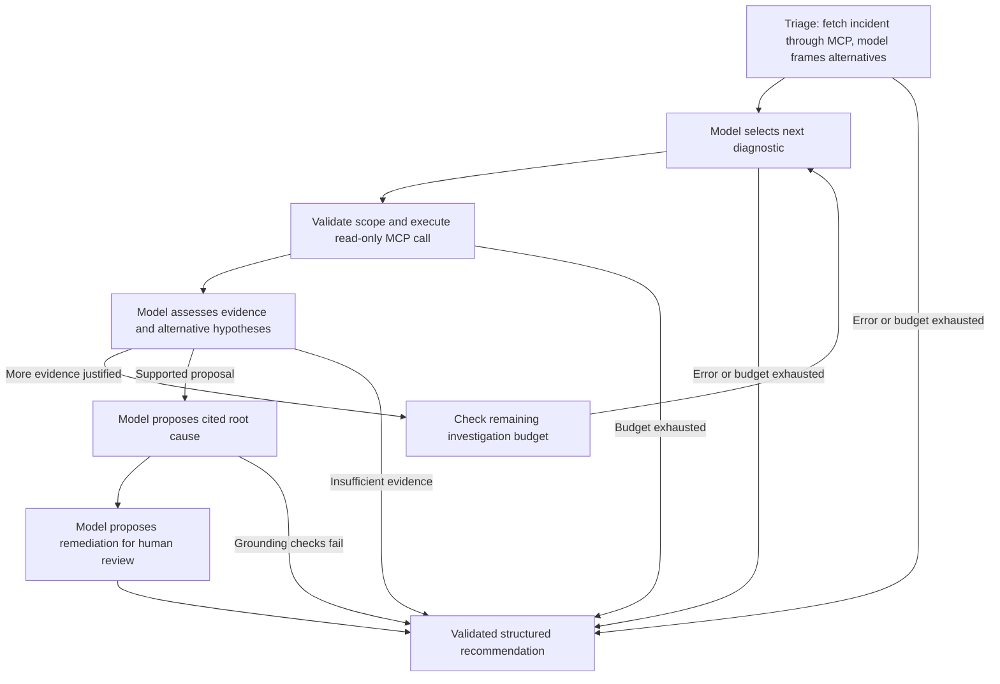

# Stage 3 investigation agent

The investigator runs a compiled LangGraph `StateGraph` over Pydantic state. It
reads the real simulator through the official MCP SDK and proposes a remediation.
No action executor, approval issuer, shell tool, file tool, database connection,
or simulator control credential is present in the agent.

## Workflow and state



Every node also routes errors to the final result. Tool failures may be assessed
and followed by a different diagnostic; they never count as fault evidence.
The final node assembles already validated decisions without an extra model call.

`InvestigationState` records incident ID, goal, scoped request, run UUID, mode,
provider/model, observations, evidence IDs, tool history with latency and outcome,
current hypotheses with supporting/contradicting citations, proposed diagnostic,
candidate cause, proposed remediation, confidence, uncertainty, status, safe error
codes, node transitions, model-call/token accounting, and final recommendation.
Source metric/log/deployment/run IDs and timestamps remain in projected evidence.
Artifacts are bounded JSON records; graph state is in memory during execution.
No database migration or resumable checkpoint service is added in this stage.

Triage deterministically fetches the requested incident first. Subsequent tool
selection, hypothesis comparison, stopping decisions, root-cause explanation, and
remediation planning are model decisions in **real mode**. The seven available
diagnostics are the Stage 2 read tools. The executor validates selected arguments
using both Stage 3 and Stage 2 schemas. Unknown tools, writes, a different incident,
out-of-scope services, and identical repeated diagnostics are rejected locally.
The authorization service independently checks the credential's permissions.

Checkout can investigate itself, payment, and inventory. Other target services are
scoped to themselves. A caller can further narrow this with `allowed_services`.
The transport requires discovery to expose exactly the seven read tools, so an
accidentally supplied operator token is rejected before investigation.

## Model interface and honest execution modes

`DecisionModel.generate(stage, context, schema)` returns a validated Pydantic
decision and provider-reported token counts when available. A model can be replaced
without changing the graph or MCP executor.

- `HTTPDecisionModel`: **real mode**, HTTP calls to an explicitly configured
  OpenAI-compatible Chat Completions endpoint or local native Ollama endpoint.
  Planning uses an actual function call named `select_diagnostic_tool` with a
  typed selection schema. This function proposes a diagnostic; the graph validates
  and performs the corresponding actual MCP call. Assessment and recommendation
  decisions use JSON-schema structured outputs. Ollama must have a model supporting
  both tools and structured JSON installed; nothing is downloaded automatically.
- `FixtureDecisionModel`: **fixture mode**, a fixed diagnostic order and explicit
  worker-utilization threshold rules for testing. It performs no inference and
  is not an implementation of LLM reasoning. It abstains outside its supported
  evidence pattern. Fixture tests do not establish real-model diagnostic quality.

The caller must choose `--mode real` or `--mode fixture`. Missing configuration,
HTTP errors, timeouts, refusals, malformed output, multiple/unexpected function
calls, and truncated output produce explicit failures. No real failure switches
to fixtures. There are no automatic provider retries or hidden repair prompts.

The adapters follow the official [OpenAI structured-output documentation](https://developers.openai.com/api/docs/guides/structured-outputs?api-mode=chat)
and [Ollama API contract](https://github.com/ollama/ollama/blob/main/docs/api.md).
The graph uses the supported [LangGraph state and conditional-edge APIs](https://docs.langchain.com/oss/python/langgraph/graph-api).
Actual installed versions are locked in `uv.lock`; provider contract tests use
mocked HTTP responses and are explicitly separate from the opt-in real smoke test.

## Evidence and decision boundaries

Stage 2 APIs retain their original contracts. The agent positively projects MCP
responses before creating observations or model context. It removes scenario IDs,
fault IDs, active-fault labels, seeds, generations, simulator event kinds, titles,
and canonical log codes that could name an injected cause. It retains measured
HTTP statuses, timings, resource utilization, request/error counts, timestamps,
correlation IDs, and observed configuration fields such as `tax_mode`.
The model never receives the operator's trigger record or expected diagnosis.
It does receive real operational evidence that can support a diagnosis.

Observation IDs such as `e002` reference a bounded, retained MCP result. Hypotheses
must cite existing observations. A cause must select an assessed hypothesis,
reference its supporting evidence, have no cited contradiction, use at least two
distinct observations, and have confidence at least 0.6 and no higher than the
assessment. Corroboration requires a nonempty post-incident quantitative window
and a separate request-log/dependency/configuration observation. Empty pages and
pre-incident metrics do not qualify. Remediation must cite the proposed cause's
evidence and target its service. Only named sandbox proposals or manual
investigation are accepted; none is executed.

These checks enforce citation integrity and conservative gates. They cannot prove
that a fluent model explanation follows logically from every cited number.
Models may still misdiagnose. Humans must review the retained evidence, uncertainty,
and proposal. Absence of a supported recommendation produces `abstained`,
`budget_exhausted`, or `failed`, with no partial actionable diagnosis in the final result.

Limits: default 8 MCP calls, 14 model calls, 180 seconds per graph run and 30 seconds
per call. Validated maxima are 12, 24, 600 and 60 respectively. Failed tool attempts
consume budget. Provider input is capped at 60,000 serialized characters and output
at 128 KiB/1,600 generated tokens; MCP results retain Stage 2's 32 KiB bound.
Stage 2's deadlines, result pagination and per-caller rates still apply.
SDK connection/discovery occurs before graph timing and has a separate 15-second
transport timeout. CLI process time is recorded separately by the operator harness.

Tool data and the user goal are explicitly untrusted prompt data. Canonical log
text is excluded from the evidence projection. Prompt instructions provide another
layer, while the independent executor allowlist prevents action execution even if
a model follows an injected instruction. Optional LangSmith tracing is disabled
for graph execution. Provider error bodies and secrets are never copied into errors.

Token counts sum only counts returned by the provider. `usage_complete=false`
means the totals are incomplete or unavailable; fixture counts are not token usage.
Cost is `null`: no universal pricing or provider billing is guessed.

## PowerShell: start and run

From the existing Stage 2 installation:

```powershell
Set-Location D:\Projects\OpsPilot-AI
$env:UV_CACHE_DIR = Join-Path (Get-Location) '.uv-cache'
uv sync --locked --python 'C:\Program Files\Python312\python.exe'
docker desktop start
docker compose --profile mcp up -d --build --wait
Invoke-RestMethod http://127.0.0.1:8084/health/ready
Invoke-RestMethod http://127.0.0.1:8085/health/ready

# Explicit operator preparation resets ONLY checkout, observes a baseline, then
# injects a checkout fault and creates an incident. This is outside the agent.
.\.venv\Scripts\python.exe -m scripts.verify_agent --mode fixture --prepare-checkout
Get-Content artifacts/stage3-fixture-investigation.json
```

The harness launches the graph in a separate process with the reader token and
selected model configuration only. It does not pass DB, operator, approval, or
simulator-control credentials. `*.trigger.json` is operator-only ground truth
stored separately and never loaded by the graph. The fault remains active so that
a human can inspect it. Repeating the command resets only checkout and retains
history; dependency cursors evolve through actual checkout requests.
For a clean installation, run the Stage 1/2 initialization and restricted-role
provisioning commands in README and MCP_TOOLS first.

To use an **already installed** local Ollama model supporting tools and JSON schema:

```powershell
$env:OPSPILOT_AGENT_PROVIDER = 'ollama'
$env:OPSPILOT_AGENT_BASE_URL = 'http://127.0.0.1:11434'
$env:OPSPILOT_AGENT_MODEL = '<your-installed-tool-capable-model>'
.\.venv\Scripts\python.exe -m scripts.verify_agent --mode real --prepare-checkout --output artifacts/stage3-real-investigation.json
```

LM Studio or another local OpenAI-compatible server uses `openai-compatible`, its
`http://127.0.0.1:<port>/v1` base URL, and the actual loaded model identifier.
A remote provider requires HTTPS, its compatible endpoint/model, and
`OPSPILOT_AGENT_API_KEY` supplied through the local environment. No default model
or paid provider is selected. The CLI does not automatically load `.env`.

To investigate an existing checkout incident without preparing or mutating fixtures:

```powershell
$opspilotReaderLine = Get-Content .env | Where-Object { $_.StartsWith('OPSPILOT_MCP_READER_TOKEN=') }
$env:OPSPILOT_MCP_TOKEN = $opspilotReaderLine.Split('=', 2)[1]
$opspilotIncidentId = (Invoke-RestMethod 'http://127.0.0.1:8084/api/v1/incidents?service_name=checkout-service&status=open')[0].id
.\.venv\Scripts\python.exe -m opspilot.agent.cli --mode real --incident-id $opspilotIncidentId --output artifacts/stage3-real-investigation.json
```

The CLI exits 0 only for a completed supported recommendation, otherwise 2.
Model/MCP failures after graph startup are retained in the run artifact. Failures
before startup print a bounded JSON error and exit 2. There is no new public HTTP
investigation endpoint or background autonomous loop.

## Verification and stopping

```powershell
.\.venv\Scripts\python.exe -m pytest tests/test_agent.py -q
docker compose --profile test run --build --rm tests pytest -q --junitxml=/artifacts/stage3-docker-tests.xml
.\.venv\Scripts\ruff.exe check .
.\.venv\Scripts\ruff.exe format --check .

# Only after explicitly configuring a real model and selecting an existing incident:
$env:OPSPILOT_RUN_REAL_MODEL_SMOKE = '1'
$env:OPSPILOT_AGENT_SMOKE_INCIDENT_ID = $opspilotIncidentId
.\.venv\Scripts\python.exe -m pytest tests/test_agent.py -m real_model -q

# Stop this project's containers; retain its database volume.
docker compose --profile mcp --profile test --profile traffic down
```

No automatic remediation or Stage 4 work is included.
