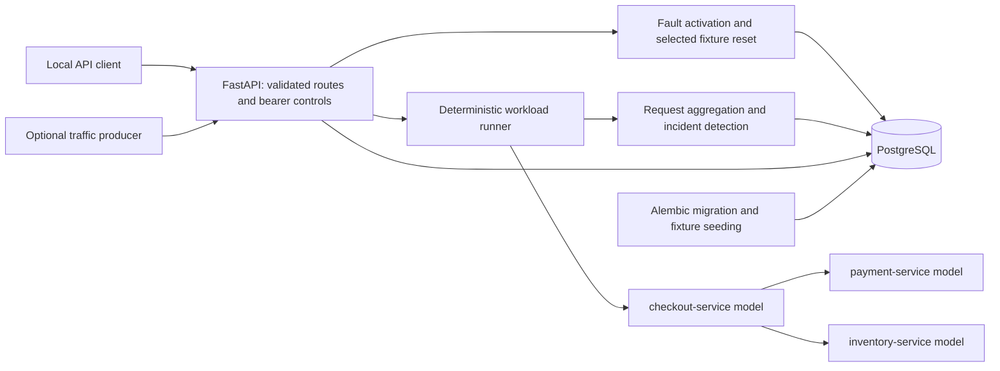

# OpsPilot architecture (Stages 1–8)

Stage 8 adds release assets and reproducible check tooling. The diagrams and hosting
plan are documented separately in [state machines](LANGGRAPH_STATE_MACHINE.md),
[threat model](THREAT_MODEL.md) and [deployment architecture](DEPLOYMENT_ARCHITECTURE.md).
Existing runtime authorization remains unchanged. See STAGE_8_REPORT.md for actual
quality results and the explicit absence of a public or real-model release.

Stage 7 hardens evidence resource/content binding, human-session rotation and
streamed-body deadlines. Its review infrastructure has a separate PostgreSQL
Compose project and per-test schemas, never a reset of the main simulator data.
See [security review](SECURITY_REVIEW.md), [reliability report](RELIABILITY_REPORT.md)
and [actual Stage 7 results](STAGE_7_REPORT.md).

Stage 6 adds a local Next.js BFF/dashboard, positively projected live read models,
persisted investigation progress and authenticated human HTTP decisions that reuse
the existing exact-intent approval transaction. The model remains read-only.
See [frontend architecture](FRONTEND_ARCHITECTURE.md) and [Stage 6 verification](STAGE_6_REPORT.md).

Stage 5 adds a trusted evaluation controller in `evaluations/runners/`, versioned
private recipes, bounded read-only comparison subjects, separate operational probes
and local content-free OTel instrumentation. The controller's reset privileges apply
only to fresh schemas in the dedicated test database and are never agent tools.
No new production API, mutation tool or approval path is exposed.
See [EVALUATION_METHODOLOGY.md](EVALUATION_METHODOLOGY.md) and
[STAGE_5_REPORT.md](STAGE_5_REPORT.md).

Stage 4 adds a separate durable remediation control plane in `opspilot/durable/`.
Completed Stage 3 investigations are persisted before an immutable approval request
is created. The model remains read-only. A human-only authenticated CLI issues a
signed exact-run grant; a persistent LangGraph workflow performs reconciliation,
approved sandbox execution and actual simulator verification. Migration
`0003_durable` adds five application tables and two nullable legacy-grant bindings;
official LangGraph checkpoint tables live in their own PostgreSQL schema.
See [DURABLE_EXECUTION.md](DURABLE_EXECUTION.md),
[APPROVAL_SECURITY.md](APPROVAL_SECURITY.md), and [STAGE_4_REPORT.md](STAGE_4_REPORT.md).

Stage 3 adds `opspilot/agent/` as an MCP client, with typed LangGraph orchestration,
model adapters, positive evidence projection, and recommendation-only output.
It has no database/control credentials and cannot invoke state-changing tools.
See [AGENT_ARCHITECTURE.md](AGENT_ARCHITECTURE.md) for state, conditional routing,
provider modes, evidence gates, budgets, and runnable commands. The original
Stage 1/2 backend and persistence boundaries below remain in force.

## Module boundaries

| Responsibility | Module |
|---|---|
| Incident and observation APIs, typed filters, bounded pagination | `opspilot/api.py`, `schemas.py` |
| Three logical services, dependency calls, queue and connection behavior | `opspilot/simulator/engine.py` |
| Validated scenario catalog, activation/deactivation, scoped resets | `opspilot/faults.py` |
| Metric aggregation and persisted request logs | `opspilot/telemetry.py` |
| Thresholds, incident deduplication, recovery events | `opspilot/incidents.py` |
| Durable state and transaction/session configuration | `opspilot/models.py`, `db.py` |
| Application lifecycle, health/readiness, safe JSON logging | `opspilot/main.py`, `logging.py`, `api.py` |
| Optional authenticated workload generation | `opspilot/worker.py` |
| Schema and initial fixtures | `migrations/` |
| Portable, PostgreSQL, and live HTTP verification | `tests/` |

## Simulation semantics

Each workload is a discrete event experiment. Its fixtures are read from PostgreSQL:
service seed, request cursor, generation, and active fault. A SHA-256 function of
seed, service name, and request index supplies stable 8–16ms processing jitter.
Python's randomized hash and the machine's scheduling do not determine metrics.

Services each have eight modeled worker slots and inventory has four modeled
database connections. A request reserves a worker; waiting over 100ms returns 503.
Inventory waits at most 80ms for a connection and otherwise returns 503. Checkout
executes payment then inventory and fails fast with 502 when a dependency fails.
Worker reservations include processing and dependency time. Slow-checkout adds
550ms of work. Saturation reserves seven workers for the first 800ms of each burst.
Database exhaustion holds four simulated connections for 1000ms per burst.
Bad-config rejects checkout processing with 500 and emits a deployment event.

The batch endpoint returns every root-request status and latency. The single-request
endpoint also sets the outer HTTP status to that simulated request's result.
The server sleeps for the burst's virtual window after atomically committing its
observations. This makes slowness observable in real HTTP duration. Wall duration
also includes database and transport overhead; summary latency describes modeled
execution only. A canceled client may still leave a committed workload.

Resources are recreated at the start of each workload; queues do not carry across
concurrent API calls. Seeds, cursors, active faults, generations, and observations
persist. Replay all involved fixture seeds and cursors via explicit reset to repeat
the same values. Checkout replay requires explicitly selecting its dependencies
too; resetting checkout alone does not silently reset payment or inventory.

## Persistence and consistency

Seven tables: `services`, `faults`, `incidents`, `incident_events`,
`deployment_events`, `metric_summaries`, and `simulation_logs`.
UUID identifiers are stored as portable 36-character strings; APIs validate them as
UUIDs. Foreign keys preserve causal references. Metric summaries have real UTC
creation timestamps, virtual-window duration, run ID, service generation, seed,
status counts, exact request/error counts, nearest-rank p95, mean/max latency, and
modeled worker/connection utilization. Logs record only fixed codes and typed
execution values; arbitrary user messages are not accepted.

Mutation transactions acquire service rows using PostgreSQL `FOR UPDATE` in a
stable alphabetical order. Checkout locks all three potentially participating
services. Partial unique indexes enforce at most one active fault and one open
incident per service. Changes, request cursors, logs, summaries, and incidents
commit together; rollback leaves no partial observations. Histories survive
process restarts. The test suite exercises row locking and concurrent activation
on PostgreSQL; SQLite is a portable test backend and does not provide these locks.

An incident opens only when observed error rate is at least 20% or p95 latency is
at least 300ms. Further unhealthy windows add observation events to the same open
incident. A healthy observation resolves it; deactivating a fault alone does not.
An explicit fixture reset resolves only the selected services' incidents with an
audited `fixture_reset` event. The next healthy checkout observation can resolve
a dependency-related checkout incident after a payment-only reset.

## Isolation and controls

All simulated work stays in this repository's processes and Compose network.
Connection exhaustion never changes the real PostgreSQL pool, and worker
saturation never floods the host. There are no arbitrary target addresses,
external commands, production credentials, or user-supplied configuration blobs.
Direct faults alter one fixture; checkout dependency propagation is intentional.

Every mutation, including workload generation, requires the configured bearer
token, compared with `secrets.compare_digest`. Missing/incorrect credentials return
401. Configuration rejects missing, short, and example control tokens. Service and
scenario enums, target compatibility, strict bounded numeric fields, forbidden
extra fields, and mandatory unique reset selections limit operation scope.
No reset endpoint accepts `all`, wildcard, empty, or implicit selections.

Read APIs are unauthenticated local observations. Host binds use loopback. This is
a local simulator trust model, with no TLS, user accounts, or Internet-facing
authorization policy. Compose app containers run as an unprivileged user with a
read-only root filesystem and dropped capabilities. Database access uses generated
local credentials and a project-specific persistent volume.

HTTP logs allowlist method, route template, generated request ID, status, and
duration. They omit raw paths, query strings, request/response bodies, headers,
DSNs, and exception details. Uvicorn access logging is disabled; its other records
use a JSON formatter. SQL parameters are hidden and SQL echo is disabled. Rejected
API inputs are not echoed in validation responses. Secrets stay in `.env` and
container environment configuration, never in application observation records.

## Startup and readiness

PostgreSQL must pass `pg_isready`; a one-shot migration container applies
`0001_stage1` and inserts the three service fixtures. Only then does the API start.
Liveness is process-only. Readiness opens a real DB connection and checks migration
revision plus service-fixture count. Missing/unavailable DB or schema gives 503
without connection details. Optional traffic starts only after API readiness.

The supported database major is PostgreSQL 18, selected using the project's
[versioning policy](https://www.postgresql.org/support/versioning/). Python
dependencies and platform artifact hashes are captured in `uv.lock`. Python,
PostgreSQL, and uv container images include exact versions and immutable registry
digests in the Dockerfile and Compose configuration.

## Stage 2 extension

The `opspilot/gateway/` package adds an SDK-backed MCP adapter (Streamable HTTP and
stdio) and a separate FastAPI authorization service. They reuse Stage 1's models
and narrow fault-deactivation operation. The MCP process has no database,
approval-signing, or Stage 1 admin credentials. It sends signed, scoped service
assertions to the authorizer. The authorizer independently enforces caller
policies, validates operator-issued one-use grants, and commits bounded actions
and audit records atomically. Its dedicated PostgreSQL role cannot create grants.

Migration `0002_gateway` adds `action_approvals`, `action_executions`, and
`gateway_audit_events`, retaining all seven Stage 1 tables and fixtures. Current
readiness checks now expect `0003_durable`. The approval CLI is not an MCP or HTTP
endpoint. The Stage 3 investigator is read-only and has no automatic approval loop.

Contracts, launch commands, compatibility limits, and the approval trust model are
in [MCP_TOOLS.md](MCP_TOOLS.md) and [SECURITY_BOUNDARIES.md](SECURITY_BOUNDARIES.md).
Historical verification remains in [STAGE_1_REPORT.md](STAGE_1_REPORT.md) and
[STAGE_2_REPORT.md](STAGE_2_REPORT.md). Current investigation verification is in
[STAGE_3_REPORT.md](STAGE_3_REPORT.md).
