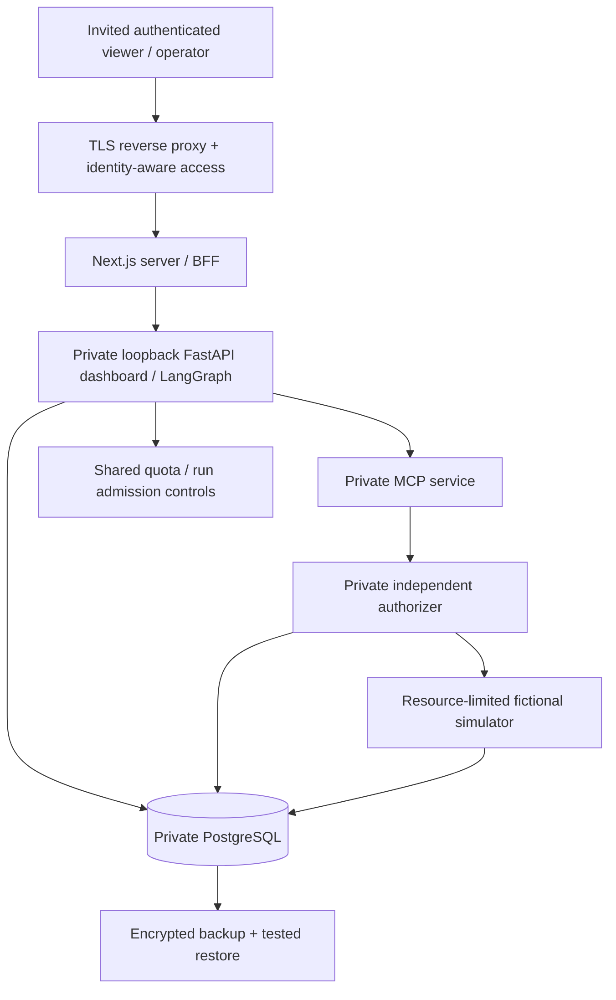

# Deployment architecture and cost plan

**Planning only. No cloud resources, public endpoint or deployment was created.**
The current implementation is a local demonstration, not an internet-ready service.
Application dependency checks and a local production build do not close that gap.

## Lowest-cost demonstration

Publish the repository, reviewed screenshots and a recorded video; run the system
locally for interviews. Incremental hosting/API spend can be zero. This demonstrates
the implemented lifecycle without maintaining a public action-capable sandbox.
There is no verified real-model recording yet.

## Recommended hosted trial after readiness work

Use one small Linux VM in a region near the audience, initially 2 vCPU / 4–8 GB RAM.
Build Next/backend images in CI rather than competing with inference/runtime memory.
This sizing is a starting estimate, not a measured capacity guarantee. Keep the
single dashboard manager and all privileged services on one host, matching existing
loopback URL validation and avoiding unsupported distributed execution.

| Component | Hosting recommendation | Public exposure |
|---|---|---|
| Next.js | Node production process/container behind TLS proxy | Only authenticated proxy ingress |
| FastAPI / LangGraph | Private process, one dashboard manager, bounded worker admission | None directly |
| PostgreSQL | Private volume on trial VM; managed PostgreSQL if operating burden justifies cost | None; least-privilege roles |
| MCP / authorizer | Separate private processes/containers with distinct secrets | None; no browser credentials |
| Simulator | Dedicated sandbox namespace/network and resource limits | No direct control API |
| Model | Explicit configured remote provider or separately hosted local server | Restricted outbound destination; no arbitrary URL |

For planning, reserve roughly **US$25–60/month** for a small VM, storage, backup and
network headroom, excluding model inference, taxes and domain. This is an engineering
budget estimate, not a vendor quote. Verify live regional prices and stock before
purchase. [DigitalOcean pricing](https://docs.digitalocean.com/products/droplets/details/pricing/)
provides a VM comparison; [Hetzner's cost-optimized catalog](https://www.hetzner.com/cloud/cost-optimized/)
showed limited availability when reviewed November 4, 2026. No instance was selected.
Managed alternatives such as [Render](https://render.com/pricing) bill compute,
private services and PostgreSQL separately; do not assume one entry-level plan
covers this entire architecture. This is a topology recommendation, not a measured
cost comparison or provider endorsement.

## Mandatory changes before any public trial

1. Authenticate **all** routes, assets and APIs at an identity-aware TLS proxy;
   require authorized operator identity for mutations and MFA for human approval.
   Keep the backend's exact-action authorization independent of the proxy.
2. Enforce shared per-user quotas, paid-model token/cost ceilings, one active run
   per user, global admission limits, request/header deadlines and circuit breakers.
   Current per-process counters are insufficient across restarts/replicas.
3. Isolate the simulator from host/cloud control planes. No Docker socket, host
   mounts, production credentials or arbitrary egress. Apply CPU/RAM/PID limits,
   scoped fixture ownership and a global disable-actions switch.
4. Expose only the TLS proxy. Keep DB/MCP/authorizer/control APIs private. Preserve
   exact configured origin, secure cookies, CSRF checks and BFF route allowlists.
   Backend loopback validation currently rules out a drop-in split-host deployment.
5. Move secrets to protected host/service secret storage. Separate migration,
   gateway, runner, operator and read credentials. Rotate/revoke and test sessions/grants.
6. Configure encrypted backups, demonstrate restore/checkpoint recovery, define
   telemetry/audit retention and off-host immutable audit exports.
7. Resolve or characterize intermittent connection/recovery timeouts; add load,
   restart, abuse and real-model adversarial tests on the target environment.
8. Re-run held-out real-model evaluation with pricing coverage and require every
   security/correctness/recovery/latency/cost release gate. Present blocked gates.
9. Audit container OS packages and image provenance, patch dependencies as needed,
   test fresh Linux setup, and obtain explicit user approval before provisioning/deploying.

Next recommends a reverse proxy for malformed/slow requests and request limits:
[official self-hosting guidance](https://nextjs.org/docs/app/guides/self-hosting).
Never rely solely on a Next routing check as the approval authorization boundary.

## Rollout and rollback plan

First use a private invited-user trial with sandbox actions disabled. Confirm read
access, quotas, provider errors and audit visibility. Enable only the three exact
sandbox actions after approval/replay tests pass. Stop admission on an incident;
disable actions, retain DB/ledger/audits and reconcile uncertain effects before
restarting. Application rollback must preserve compatible schema/checkpoints;
restore only from an independently tested backup plan. No automatic rollback grant
or irreversible action is added by this plan.
