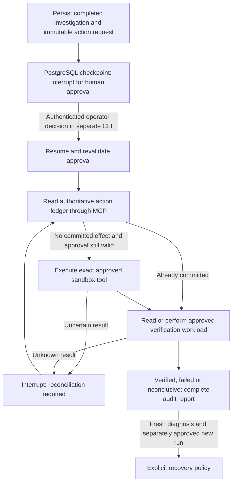

# Durable execution and recovery

Stage 4 accepts a completed, validated Stage 3 investigation and persists it before
requesting approval. A separate deterministic LangGraph workflow handles approval,
execution, reconciliation and verification. The LLM remains a read-only investigator;
neither approval credentials nor the execution client are exposed as model tools.

## Workflow and persistence



The official `AsyncPostgresSaver` persists graph checkpoints in a dedicated
`opspilot_checkpoints` schema. Its setup runs with autocommit and dictionary rows.
Serialization uses strict safe MessagePack types with pickle fallback disabled.
The graph stores JSON-compatible run/request/status references; the complete typed
investigation, evidence and results are durable application records.
Every graph invocation uses `durability="sync"`. The Stage 3 run UUID is the stable
Stage 4 run ID and LangGraph `thread_id`; execution never allocates a replacement
thread during recovery. Repeated submissions return the original request only if
the complete input digest matches. They do not extend its expiration.

Application migration `0003_durable` adds:

- `durable_runs`: immutable investigation input/digest, incident/resource, optional
  recovery parent, execution status and recorded results.
- `remediation_approvals`: exact action intent, arguments, evidence, preconditions,
  risk, verification plan, expiry, fingerprint and human decision fields.
- `durable_attempts`: separately committed action/verification delivery attempts.
- `remediation_verifications`: one atomic measurement/result per action request.
- `durable_audit_events`: append-only ordered events.

Stage 2's `action_approvals` gains nullable durable request/fingerprint bindings.
Legacy operator approvals retain their original behavior for legacy callers.
The new `durable-executor` principal always requires a run-bound approval and cannot
use a legacy unbound grant. Existing Stage 1/2 tables and history are retained.

The handoff starts after Stage 3 has completed its bounded investigation. An LLM
call interrupted before that handoff is not resumed by this execution graph.
Once submitted, the entire completed investigation and every remediation phase
survive worker restart. There is no in-memory substitute for PostgreSQL.

## Concurrency, side effects and uncertain results

A PostgreSQL session advisory lock excludes concurrent drives of the same run
across processes. It is held during graph invocation, released when the graph
interrupts/finishes, and released by PostgreSQL when a crashed process disconnects.
A competing resume receives `RUN_BUSY` and an audit event. Connection health is
checked at node boundaries. Locks are never stolen after a local lease timeout.
A network partition can delay recovery until PostgreSQL releases the old session.

This lock protects graph progression; **checkpointing does not provide exactly-once
side effects**. The independent authorization backend enforces those effects:

1. Each run derives one stable action `request_id` with UUIDv5. It survives retries.
2. Before delivery, the coordinator commits an attempt record. It reads the backend
   ledger before every initial delivery or redelivery.
3. The backend locks the involved services and approval, rechecks policy, signature,
   exact arguments, target, expiry, revocation, current incident and metric versions.
4. Fault deactivation, one-use approval consumption, the unique `action_executions`
   record, deployment event and durable audit event commit in one PostgreSQL
   transaction. A rollback exposes none of those effects.
5. After an acknowledgment is lost, `get_action_execution` returns the committed
   result for the exact binding. A duplicate action tool request is rejected; the
   coordinator reconciles rather than treating that rejection as a new action.
6. An unavailable ledger never justifies blind redelivery. The workflow interrupts
   for reconciliation; a later resume reads the ledger first. There are at most
   three prepared action deliveries and three verification deliveries per run.

Reconciliation is allowed to read a committed historical action after its approval
TTL expires. That does not authorize another action. If nothing committed and the
approval expired or was revoked, execution is rejected. Terminal runs reject
replayed resumes. These are local transactional guarantees for the fictional
simulator, not guarantees for arbitrary remote APIs or physical worker processes.

## Verification and recovery

The human approves a bounded verification plan along with the action. Default:
12 checkout requests, 25ms spacing, error rate at most 5%, p95 at most 250ms.
The workload executes the actual Stage 1 service/dependency simulator. It creates
new metric windows and request logs and updates incident state. Health follows
those measurements; deactivating a fault alone does not prove recovery.

`verify_simulated_remediation` requires the matching committed action and consumed
approval. Its workload, summaries, logs, incident updates and unique verification
record commit together. Replaying verification returns the stored result without
another observable workload. Missing relevant samples are inconclusive; threshold
violations are failed. Results include measured latency/error rate, sample counts,
run/metric references and `recovery_requires_new_approval`.

Verification proves health only for the approved workload/window. A simultaneous
30-request burst can still exceed healthy queue capacity after a successful worker
restart. Tests explicitly distinguish an action effect from successful recovery.

A failed/inconclusive verified action cannot trigger another remediation by itself.
Recovery requires a new completed investigation, new run ID, current evidence and
preconditions, and a separately authenticated human approval. `--recovery-of`
links the new request to a parent with a recorded action and failed/inconclusive
outcome. No automatic rollback or irreversible action is implemented.

## MCP additions

Existing seven read tools and three sandbox actions remain. A separate executor
credential additionally discovers:

- `get_action_execution`: bounded exact-run ledger reconciliation, no mutation.
- `verify_simulated_remediation`: one approved, bounded observation workload.

Both require `service_name`, `approval_id`, stable `request_id`, `run_id`, and
`action_fingerprint`. The three action tools accept those additional bindings for
Stage 4. The backend compares the complete argument object against the approved
record. The Stage 3 reader credential still discovers exactly seven read tools.

## PowerShell setup

Run from this project. Existing local credentials are preserved.

```powershell
Set-Location D:\Projects\OpsPilot-AI
$env:UV_CACHE_DIR = Join-Path (Get-Location) '.uv-cache'
uv sync --locked --python 'C:\Program Files\Python312\python.exe'

# Start PostgreSQL, apply the new migration, then provision separate local roles.
docker compose up -d --wait db
.\.venv\Scripts\alembic.exe upgrade head
.\.venv\Scripts\python.exe -m scripts.initialize_durable
docker compose --profile mcp build api
docker compose --profile mcp up -d --no-build --wait
.\.venv\Scripts\python.exe -m scripts.verify_durable_boundaries
```

`initialize_durable` creates ignored, image-excluded `.runner.env` and
`.operator.env`. The worker file contains a restricted DB credential and a scoped
MCP token, with no approval key or human token. The operator file is only for the
trusted human terminal. No model or provider is installed/configured by this stage.
The existing action feature flag remains **false** by default.

Prepare a new fixture investigation, then persist an approval request:

```powershell
.\.venv\Scripts\python.exe -m scripts.verify_agent --mode fixture --prepare-checkout --output artifacts/stage4-investigation.json
.\.venv\Scripts\python.exe -m opspilot.durable.cli start --investigation artifacts/stage4-investigation.json
```

Fixture mode is deterministic testing, not LLM reasoning. A configured real Stage 3
provider can instead produce the investigation with `--mode real`. The exact
observations must match successful persisted MCP audits and current metric windows.
Old or edited evidence is rejected.

The `start` output contains run ID, approval ID, exact action, fingerprint and
verification plan. It stops at a durable interrupt and executes nothing.
In a separate trusted human terminal, review the request:

```powershell
.\.venv\Scripts\python.exe -m opspilot.durable.operator approve --approval-id <approval-uuid>
# To revoke a pending/approved request instead:
.\.venv\Scripts\python.exe -m opspilot.durable.operator revoke --approval-id <approval-uuid>
```

Enter the local operator credential at the hidden prompt, then type the exact
displayed fingerprint phrase. Retrieve the bootstrap credential privately from
`.operator.env`; do not send it to the model. There is no `--yes`, approval API,
token argument, environment-token auto-approval or unattended signing path.

To execute an approved request, a human must also explicitly enable the existing
`OPSPILOT_GATEWAY_ACTIONS_ENABLED=true` sandbox feature flag in `.env` and recreate
the authorizer. Approval alone does not override that flag.

```powershell
# After explicitly enabling the flag in the local .env:
docker compose --profile mcp up -d --no-build --wait authorizer mcp
.\.venv\Scripts\python.exe -m opspilot.durable.cli resume --run-id <run-uuid>
.\.venv\Scripts\python.exe -m opspilot.durable.cli report --run-id <run-uuid>
```

After a process restart, use the same `resume` command and run UUID. `Command`
payloads only wake a checkpoint; the database approval remains authoritative.
If a run is inconclusive due to uncertain delivery, restore the downstream service
and resume for reconciliation. A confirmed failed action requires a new request:

```powershell
.\.venv\Scripts\python.exe -m opspilot.durable.cli start --investigation artifacts/fresh-recovery-investigation.json --recovery-of <failed-run-uuid>
```

This creates another approval request; it does not execute recovery automatically.

The local operator report includes the full ordered workflow events and gateway
attempts, plus a merged audit timeline. It is an administrative CLI export, not
an unbounded MCP tool response. Audit exports grow with retained history.

## Verification and stopping

```powershell
docker compose --profile test up -d --wait test-db
# Dedicated PostgreSQL test URL; capture the value without displaying its password.
$env:OPSPILOT_TEST_DATABASE_URL = & .\.venv\Scripts\python.exe -c "from dotenv import dotenv_values; from sqlalchemy.engine import make_url; v=dotenv_values('.env'); print(make_url(v['OPSPILOT_DATABASE_URL']).set(database='opspilot_stage1_test',username='opspilot_test',port=55433).render_as_string(hide_password=False))"
.\.venv\Scripts\python.exe -m pytest tests/test_durable.py -q --basetemp=artifacts/pytest-durable

docker compose --profile mcp --profile test --profile traffic down
```

The optional test DB binds only `127.0.0.1:55433`. Each test uses its own UUID
schema and removes only that schema. Windows commands use a selector event loop
for Psycopg async; the CLI configures this automatically. The durability suite
never substitutes SQLite or an in-memory saver for PostgreSQL.
