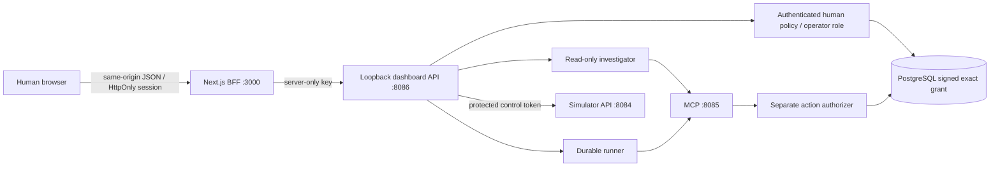

# Stage 6 frontend architecture

The BFF receives only a service key and loopback backend URL; neither is
`NEXT_PUBLIC_`. Database/MCP/control/signing credentials stay in Python private
configuration. Humans type their credential during login; it is never prefilled,
returned by an API, stored in localStorage, logged or given to a model. Sessions
use random opaque HttpOnly SameSite=Strict cookies; only credential/account/subject-bound
HMAC digests are stored. Expiration/revocation and current registry permissions are
checked on protected operations. Credential rotation invalidates old cookies;
legacy sessions require login again after the Stage 7 change.

The BFF enforces a fixed method/path allowlist, no query-string proxy, a loopback
destination, no redirects, 16 KiB streamed JSON bodies, an absolute five-second
body-read deadline and exact same-origin checks. The backend independently bounds
body size and elapsed read time.
It forwards only the selected session cookie, not browser-chosen authorization.
Fetch deadlines are 60s for four-step simulator setup, 20s for other operations.
The backend independently checks the service key and configured mutation origin.
There is no arbitrary tool, file, shell or SQL endpoint and no permissive CORS.

The dashboard backend is trusted orchestration code and loads separate restricted
runner/operator credentials. The model receives only its read-only MCP client.
This is a local OS trust boundary, **not isolation against malicious Python code
on the host**. Remote use would require an independently operated identity service,
TLS, protected keys and distributed rate limits. No such deployment is claimed.

## Pages and data sources

| Route | Actual data |
|---|---|
| `/` | Three service observations, incidents, persisted runs and audit records |
| `/incidents`, `/incidents/:id` | Incidents; last 20 metric windows, 100 request logs, 50 events |
| `/workspace`, `/workspace/:id` | Persisted graph snapshots, MCP history/citations, hypotheses and durable report |
| `/approvals` | Exact intents, effective expiry/state, human approve/reject and explicit resume |
| `/evaluations` | Fixed allowlist of historical Stage 5 aggregate report files; no held-out answers |
| `/architecture` | Implemented routing map, backend dependencies and introspected twelve-tool inventory |

The diagram is an implementation map, not a fabricated live animation. Evaluation
arms without models remain unavailable; one recorded benchmark version cannot
support a superiority claim. Live incident views have no demonstration records.
Polling does not overlap. Loading, empty, stale data and failures are distinct.
Approval/execution success is never optimistic. React escapes all telemetry;
there is no raw HTML rendering. Positive projections exclude fixture metadata.
Read views derive rejected/expired labels from the authoritative approval when a
durable graph is still interrupted at its approval node; they never claim it is
still awaiting a possible human decision after revocation or expiration.

## Backend contracts

Browser prefix is `/api/ops`; backend paths are:

| Endpoint | Schema / behavior |
|---|---|
| `GET /health/ready` | Actual database migration readiness; safe 503 on failure |
| `GET /meta` | Provider availability, action flag, optional human subject/scope; no secrets |
| `POST /session` | `{credential: string[32..256]}` authenticates local human registry |
| `DELETE /session` | Revokes session digest |
| `GET /overview`, `/incidents`, `/runs`, `/approvals` | Bounded actual read models, at most 100 incidents / 50 runs or approvals |
| `GET /incidents/{uuid}`, `/runs/{uuid}` | Bounded evidence, progress and optional durable report |
| `POST /simulation` | Validated FaultCreate `{service_name,scenario_id}`; explicitly selected service reset, actual traffic, observed incident UUID |
| `POST /runs` | `{request_id: UUID,incident_id: UUID,mode: real\|fixture,max_seconds: 0.1..180}`; persisted job, 202 |
| `POST /approvals/{uuid}/decision` | `{decision: approve\|reject,fingerprint: SHA256}`; identity exclusively from session |
| `POST /runs/{uuid}/resume` | Reuses stored exact intent; no tool arguments accepted |
| `GET /evaluations` | Recorded aggregates/gates; missing files cause failure rather than sample data |
| `GET /architecture` | Dependency map and actual MCP registry |

Writes require a human session and permitted service/action scope. Login allows
five attempts/minute, human writes thirty/minute, simulator setup six/minute;
MCP retains independent rate limits. Extra keys and invalid UUIDs are rejected;
validation does not echo input. No secrets or bodies are included in request logs.

## Persistence and execution

Migration `0004_dashboard` adds progress/session tables. The runner can write only
dashboard progress in addition to its existing Stage 4 privileges; the operator can
manage session rows. Existing immutable approval/audit triggers remain intact.
Optional stable run-ID/progress callbacks preserve default investigation behavior.
Deadline classification uses the actual async timer-expiry state rather than a
second clock sample, keeping total-budget exhaustion distinct from per-call
failures even with Windows timer rounding.

One API process admits up to eight tasks and runs one at a time. A repeated launch
UUID returns its persisted run. Completed graph nodes persist snapshots. After a
process restart, unfinished investigations become `interrupted`; paid inference
is never silently repeated. The Stage 3 investigation itself is not a checkpointed
durable graph. Following handoff, the Stage 4 PostgreSQL saver, stable thread ID,
advisory resume lock, action ledger, reconciliation and transactional effects apply.
Do not operate multiple dashboard API job managers against the same database.

The web API authenticates a human and calls the same `decide_authorized` transaction
as the existing CLI. It checks scope, full fingerprint, expiry/state and live
preconditions before issuing the HMAC grant and appending a human audit event.
CLI TTY/typed-phrase requirements remain. Web rejection records revocation and
never authorizes execution. Approval does not automatically run an action.

Resume uses the exact stored action and separate executor MCP identity. Verification
generates the already-bound measured workload after the committed effect. Only
persisted `verified` means verified recovery. Failed/inconclusive verification
causes no automatic follow-up action. Audit views have 100 events/source and an
explicit truncation indicator; the existing CLI provides the complete export.
Simulator setup spans multiple transactions; a timeout can leave partial setup,
which is reported honestly. Its reset/injection sequence is not an exactly-once
remediation claim.

## Compatibility and verification

Exact versions are in package-lock.json. Setup follows the installed version's
Next route-handler/environment documentation, [Next installation](https://nextjs.org/learn/react-foundations/installation),
[Tailwind's Next guide](https://tailwindcss.com/docs/installation/framework-guides/nextjs)
and [Playwright browser setup](https://playwright.dev/docs/browsers). Fonts are local.
The isolated browser harness uses actual Chromium, TCP MCP and PostgreSQL with
synthetic human identities. See STAGE_6_REPORT.md for actual outcomes and limits.
