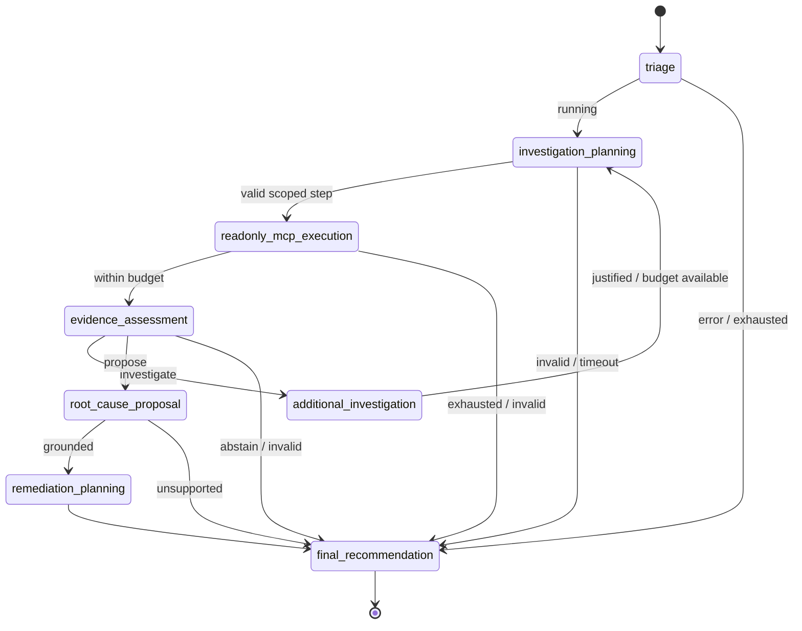
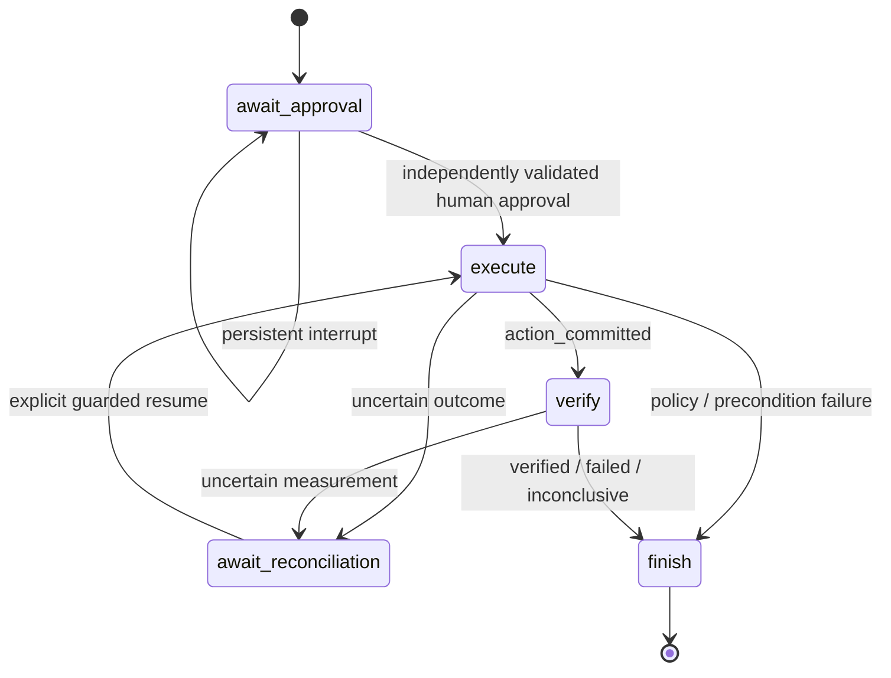

# LangGraph state machines

Two compiled graphs have different persistence guarantees. These diagrams map the
implementation; they are not live traces or claims of real-model performance.

## Investigation

Source: `opspilot/agent/workflow.py::_compile`; Pydantic state:
`opspilot/agent/schemas.py::InvestigationState`.

Every node wrapper records safe errors and transitions. Failed tools are missing
evidence, never proof of a cause; assessment may justify a different diagnostic.
Default limits are eight tools, fourteen model calls and 180 seconds, with validated
overrides. Identical repeated diagnostics are rejected. Scope is independently
checked by the MCP gateway and authorization backend.

State records incident/run identity, goal, execution mode/provider/model,
observations and evidence references, tool arguments/outcomes/timings, hypotheses
with supporting/contradicting citations, next diagnostic, candidate cause, proposed
remediation, confidence, uncertainty, usage, errors, transitions and run status.

The dashboard persists completed-node snapshots. Investigation runs in memory;
unfinished inference becomes interrupted after restart and is never silently
repeated. Real mode calls the configured provider; fixture mode uses fixed rules
and no inference. Resource/content checks enforce cited facts, not causal truth.
MCP transport exception groups may end a run before a final recommendation.

## Durable approved action

Source: `opspilot/durable/workflow.py::_compile/drive`; PostgreSQL saver and advisory
lock: `opspilot/durable/persistence.py`. Stable `thread_id` equals the stored run ID.

Resume data wakes a graph; it supplies no approval authority. Execution revalidates
exact fingerprint, target/arguments/run, expiration/revocation and live preconditions.
The gateway commits grant consumption, reversible simulator effect and unique
ledger row atomically. A missing acknowledgment requires authoritative reconciliation
before redelivery. Advisory locks exclude concurrent resumes.

Synchronous PostgreSQL checkpoints persist graph progress. Checkpointing alone
cannot guarantee exactly-once side effects. A successful action also needs the
bound workload to meet health/latency/error thresholds before recovery is verified.
Failure grants no follow-up authority: recovery needs a new intent and human decision.
[Exact guarantees and failure tests](RELIABILITY_REPORT.md).
