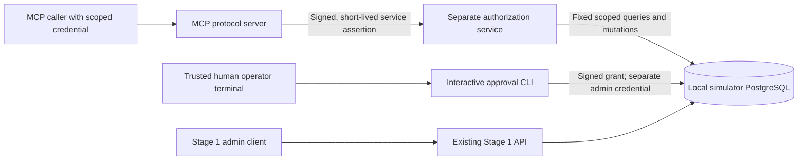

# Security boundaries (Stages 2–7)

Stage 6 adds a human-facing authenticated loopback HTTP decision API behind a
strict Next.js BFF. It shares the Stage 4 intent-binding transaction. The model
remains a seven-tool read-only MCP client. See [frontend architecture](FRONTEND_ARCHITECTURE.md).

Stage 4's exact-run human approval, least-privilege DB roles and execution/recovery
boundary are documented in [APPROVAL_SECURITY.md](APPROVAL_SECURITY.md). The
investigator remains read-only. A separate deterministic executor receives only
run-bound sandbox authority; checkpoint resume data never constitutes approval.

## Stage 3 investigator

The graph is a credential-scoped read-only MCP client. Its executor independently
allowlists the seven diagnostic tools and rejects operator credentials during
discovery. Model output can select a diagnostic or propose a remediation; neither
constitutes approval, and no graph node can invoke a state-changing tool.
The separate Stage 2 authorization service and human approval mechanism remain
unchanged. Action tools stay disabled by default.

Positive evidence projection removes fixture truth and canonical cause labels
before observations enter model context. Citations, service/incident scopes,
typed decisions, time/call budgets, error states, and abstention are checked in
code. These checks do not prove model semantic correctness. Tool data and goals
remain untrusted. Graph tracing is disabled, and provider errors use fixed messages.
The operator test harness is outside the graph and passes only a reader credential
and selected provider configuration to its child process. See
[AGENT_ARCHITECTURE.md](AGENT_ARCHITECTURE.md) for the complete boundary and limits.

## Trust and process boundaries

| Component | Credentials and privileges | Explicit exclusions |
|---|---|---|
| MCP process | Caller token digests, service delegation key | No DB credential, approval key, Stage 1 control token, client-token inventory, host mount, Docker socket, or approval endpoint |
| Authorization service | Limited DB role, caller policies, delegation verification key, grant verification key | No grant INSERT privilege, arbitrary command tool, public host port, or Stage 1 control token |
| Human operator CLI | Operator-owned admin DB credential and approval-signing key | Not exposed through MCP/HTTP; no automatic approval mode |
| MCP client | Its selected caller token | No authorization from clientInfo, caller IDs in arguments, log text, tool annotations, or approval flags |
| Test harness | Dedicated test DB/schema and synthetic credentials | No runtime grant issuance; test DB name/host restrictions remain enforced |

The MCP HTTP container receives only its three configured gateway variables. A
stdio child additionally receives its selected launch credential. Stage 1's API
keeps its existing separate admin credential and behavior. Possessing that
credential remains an administrative route outside the MCP boundary; it is never
available to the MCP process. Both new containers run as UID 10001 with a read-only
root filesystem, dropped capabilities, and no privilege escalation.

## Identity and permissions

HTTP credentials are pre-provisioned random 256-bit local tokens. Only their
SHA-256 digests appear in the server registry. Authentication uses constant-time
digest comparison; it is repeated on every HTTP request. The optional stdio server
derives its principal from the launcher's environment credential. No stdio request
argument can replace that principal, and HTTP requests never use the stdio fallback.

Discovery uses a fixed ten-tool registry, filtered by the caller's exact tool
permissions. Tool schemas reject extra fields and constrain service names, UUIDs,
integer bounds, literal statuses, and query lengths. Both the protocol adapter and
separate backend validate the typed arguments and enforce service permissions.
`get_incident` queries by incident UUID **and** authorized service, so an incident
from another service cannot be relabeled. Dependency details require scope for
every returned dependency; restricted callers receive a denial rather than leaked
payment/inventory details. Unknown tools never reach dynamic attribute dispatch.

MCP bearer tokens are not passed through to downstream services. The adapter signs
an internal assertion over subject, fixed backend path, correlation UUID, timestamp,
and SHA-256 body digest. The backend verifies its HMAC, 30-second freshness, known
principal, exact path/body binding, and its own policies. Unique audit request IDs
reject assertion replay. Redirects and proxy-environment inheritance are disabled
for backend HTTP calls. The backend URL is deployment configuration restricted to
the local authorizer/loopback, never a tool argument.

## Action approval and execution

Actions are disabled by default, including for callers with action permissions and
even if a syntactically valid approval ID is supplied. Only the authorization
service evaluates the action-enable flag, validates signed approval records, and
executes bounded simulator mutations. The MCP server cannot approve an action.

The operator issues approval through an interactive terminal command. Its record
binds an approval UUID, exact subject, action, service, active fault UUID, operator
identity, and expiry. An HMAC also binds the issuing workflow's fixed source marker.
The backend verifies all bindings and the signature. A UUID, model statement,
MCP request, elicitation response, arbitrary header, or `human_approved` argument is
never accepted as approval. There is no approval-issuance MCP route. The Stage 6
HTTP decision route requires an independently authenticated human session and full
fingerprint; it does not accept a client-selected approver identity.

Terminal confirmation is an operator interface, not a cryptographic proof that a
human is present. This design trusts the local operator's OS account and protects
its credentials from the MCP process. A host administrator or process already able
to steal operator credentials, forge terminals, or directly modify the database is
outside this boundary. Do not give an LLM terminal/admin access and call its input
human approval. No such agent or terminal tool is included here.

The authorization DB role has SELECT access to observation tables and narrowly
granted mutation columns. It cannot insert or edit approval bindings/signatures,
delete records, create tables, or assume a superuser role. It can update only an
approval's `consumed_by` column. A service cursor UPDATE privilege is required for
PostgreSQL's service-row `FOR UPDATE` locking; the gateway never uses it to reset
the cursor. Issuance runs with the separate operator-owned database credential.

Execution locks the selected service and approval record. It verifies that the
approved fault is still active and matches the action mapping. A replacement fault,
even with the same scenario/service, invalidates the old approval. Fault
deactivation, consumption, a unique execution record, deployment evidence, and
audit outcome commit atomically. Unique constraints on execution request ID and
approval ID, plus row locking, prevent concurrent/replayed actions from executing
twice. Validation failures roll back the action savepoint and retain denial audits.

Only these remediation effects exist:

- Restart worker: deactivate the selected `worker-saturation` fixture fault.
- Roll back configuration: deactivate selected checkout `bad-config`, recording rollback.
- Reset dependency: deactivate selected payment-unavailable/inventory-db-exhaustion fault.

None executes a shell, restarts host/container processes, changes real PostgreSQL
capacity, reads files, resets other services, or uses cloud credentials. Seeds and
request cursors remain unchanged. Recovery still requires healthy observations.

## Bounds, timeouts, and audit

Pages are at most 20 rows, event lists at most 20, queries at most 128 characters,
argument JSON at most 4096 bytes, and HTTP bodies at most 16384 bytes. Structured
tool results are at most 32768 serialized bytes before the MCP JSON text copy.
Log/deployment strings are bounded and control characters are removed. Fixed
configuration keys are allowlisted. Unknown raw event payload fields are not exposed.

Default caller limits are 60 tool calls/minute at the adapter and backend, plus
5 action attempts/minute at the backend. State is bounded by at most 16 configured
identities. Limits are per process; containers use one worker. Backend HTTP calls
have three-second deadlines; a local denial audit can take up to three additional
seconds if the backend is unavailable. PostgreSQL statement and lock timeouts are
two seconds and one second. Streamed body reads have five-second idle deadlines.
SDK parser logging that might echo rejected JSON is suppressed in favor of fixed,
allowlisted audit messages. Indefinite HTTP listen streams are not exposed.

Successful and denied signed requests are stored in `gateway_audit_events` with
correlation ID, configured subject, allowlisted tool, selected service where known,
outcome, and action/approval IDs. Operator grant creation is audited. Arguments,
query text, bearer credentials, HMAC keys, DB passwords, and raw observation/log
contents are never written to these audits. If DB auditing fails, the transaction
fails and no action commits. Authentication/parser/transport failures and network
failures have fixed JSON security records; if the backend is unreachable, a durable
DB denial record cannot be promised. Requests are denied and this loss is logged.

An action timing out at the network boundary may already have committed. Its error
is marked non-retryable; retain the original execution UUID and inspect observation
and operator audit evidence before issuing anything else. The server never retries
actions automatically. The unique request/grant records survive process restarts.

## Untrusted observation data

Every response declares `untrusted_data=true`, including typed errors. Data is
validated again after crossing the backend boundary. Invalid schemas, inconsistent
success/error states, oversized results, unavailable downstream services, and
timeouts produce explicit errors with no data. Search strings use parameterized,
escaped literal matching; `%`, `_`, SQL fragments, and imperative log text are data.
No tool accepts arbitrary SQL, Cypher, filesystem paths, or system commands.

Sanitizing and labeling text do not guarantee that an LLM will ignore prompt
injection. The stronger boundary is that no response text can authorize an action,
issue a grant, change a principal, or add a new tool. The included clients do not
interpret logs as commands and do not chain observations into autonomous actions.

Stage 7 additionally binds MCP observations to their requested service/incident
and fixed dependency topology. Approval handoff compares cited projected facts
with persisted telemetry, rather than trusting IDs alone. Human session cookies
are bound to current credentials, and streamed request bodies have absolute
deadlines. See [the adversarial review](SECURITY_REVIEW.md) for tests, known gaps
and the explicit absence of real-model adversarial verification.

## Protocol compatibility and deployment limits

Both SDK transports exercise the current MCP protocol's discovery and typed tool
calls. STDIO uses launch-environment credentials, consistent with the
[transport authorization guidance](https://modelcontextprotocol.io/specification/2026-07-28/basic/authorization).
The loopback HTTP endpoint uses a documented, pre-provisioned bearer-token profile.
It does **not** implement the full optional OAuth 2.1 authorization-server discovery,
browser login, PKCE, refresh-token, or Protected Resource Metadata flow. We do not
claim conformance to that optional HTTP OAuth authorization profile. Clients must
be configured with the local bearer credential; automatic OAuth-login clients are
not supported. No existing token from another service is accepted or forwarded.

This is local simulator infrastructure: no TLS, public hosting, multi-user identity
provider, distributed rate-limit store, or automated credential rotation. A
distributed deployment would require those controls, audit retention, transport
policy review, and production DB/RLS design. None is implemented or deployed in
these stages. Stage 3 adds investigation and recommendations only; automatic
remediation and further autonomous response stages remain outside the scope.
