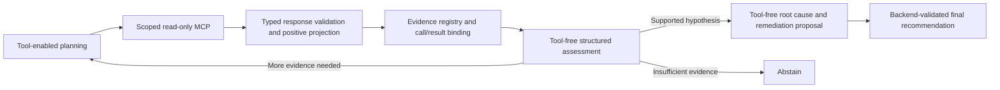

# Stage 9E — Provider-compatible diagnosis pipeline

Date: 19 November 2026. **BLOCKED end-to-end verification. Stage 9F must not begin.**
The user separately approved one Stage 9E investigation. It made 12 provider
requests and stopped on HTTP 413 with a token-limit error. No final diagnosis or
remediation was accepted. The offline implementation is verified; the live pilot
did not pass. No second attempt is authorized or performed.

## 1. HTTP 400 diagnosis

The preserved [Stage 9D ledger](../evaluations/reports/stage9d/20261119T041059Z-ee96b9/requests.json)
and the [offline audit](../evaluations/reports/stage9e/20261119-offline/audit.json)
show the full-diagnosis request C had `tool_count=0`, roles `system,user`, strict
`response_format`, medium reasoning, `include_reasoning=false`, and `max_tokens=1600`.
The unchanged request-construction code sets `stream=false`. The older ledger did
not separately persist that flag; Stage 9E's new ledger records it explicitly.
`client.stream(...)` reads an HTTP response with a bounded buffer; it does not turn
on model streaming. No tools or tool transcript were present in this failed C request.

| Question | Evidence-backed answer |
| --- | --- |
| Tools and strict response format together? | No, in failed C or the production adapter's request declarations. Planning declares tools; other decisions declare strict output. |
| Model streaming enabled? | No in the actual construction path; the body explicitly sets false. |
| Strict object requirements satisfied? | Yes offline, including nested definitions: all properties required, `additionalProperties=false`, defaults removed, nullable keys still required. |
| Unsupported keywords? | No offending keyword identified by the provider. Inventory includes `$defs`, `$ref`, `anyOf`, `const`, enums, regex, length/item/numeric bounds and annotations. Formal schema validity does not establish hosted decoder compatibility for every keyword. No constraint was stripped or weakened. |
| GPT-OSS parameters compatible? | Documented medium reasoning and `include_reasoning=false`; no unsupported `reasoning_format`, no streaming. `max_tokens` is documented but deprecated in favor of `max_completion_tokens`; it is retained to avoid an unproven causal change. Basic/minimal requests with the same parameter profile passed in Stage 9D. |
| Schema rejection or generated-output rejection? | HTTP 400 `json_validate_failed`/`invalid_request_error` establishes rejection at provider structured-generation enforcement, before local parsing. There was no specific `invalid_json_schema` error, schema path, finish status or token usage. It cannot prove whether compilation, generated output, model behavior or completion budget caused the failure. |

The provider supplied an empty `failed_generation` field. That is missing useful
diagnostic content, not proof that the model emitted zero tokens or malformed JSON.
The exact internal HTTP 400 cause remains **unresolved**. This stage does not claim
that removing a feature combination fixes the historical C failure.

The [official structured-output guide](https://console.groq.com/docs/structured-outputs)
requires closed, required objects and separates structured output from tool use
and streaming. Its examples document nullable unions and local reusable definitions.
The page does not provide an exhaustive, verified supported-keyword matrix for
this exact generated schema. The offline audit retains that uncertainty.
The [API reference](https://console.groq.com/docs/api-reference) documents the token
parameters; [reasoning controls](https://console.groq.com/docs/reasoning) document
the GPT-OSS profile. Documentation is not a substitute for a successful full diagnosis.

## 2. Phase boundaries and architecture changes

The existing LangGraph nodes, state contracts, conditional routes, persistence,
PostgreSQL checkpointer and action workflow are unchanged. No orchestration
framework or checkpoint store was added.



A separate boundary issue was confirmed: `evidence_assessment` previously included
assistant/tool protocol messages while requesting strict output. This is removed
from **all structured decisions**. Only the tool-enabled planning phase receives
the rebuilt protocol transcript. Structured requests contain system/user messages,
the validated projected observations and evidence registry; no tools, tool controls,
assistant function calls, tool-result messages or raw `tool_history`.

The transcript's exact argument, target, provider call ID, MCP request ID and
observation bindings are still validated before transfer. They remain in typed
state/history and checkpoints; stripping them from phase B's HTTP envelope does
not remove validation or erase audit history. Unknown/replaced results fail before
HTTP dispatch. Positive projection still removes fixture truth and malicious log
commands before observations reach the model.

A new Groq request preflight enforces disabled streaming, one read-only diagnostic
selector, separation of tools/strict output, tool-free structured messages, closed
objects and resolvable local definitions. It never repairs a failed diagnosis or
silently downgrades to JSON-object mode. All original citation, confidence,
corroboration, explicit abstention and human-approval requirements remain.

Two offline reproductions also exposed a response-boundary gap: a structured turn
could accept valid JSON accompanied by an unexpected tool call, with either `stop`
or `tool_calls` completion status. The old path ignored those calls; it did not
execute them. Structured turns now require `stop` and reject tool/function payloads
even alongside valid JSON. Both failing reproductions are preserved in
`artifacts/stage9e/output-before.xml`, with the corrected cases passing in the final
regression. This is a local contract correction, not a cause of the earlier HTTP 400.

## 3. HTTP 429 diagnosis and pacing

Historical D's structured continuation returned `rate_limit_exceeded`, error type
`tokens`, with these retained values:

| Header | Observed | Meaning |
| --- | ---: | --- |
| `x-ratelimit-limit-tokens` | 8000 | TPM according to provider documentation |
| `x-ratelimit-remaining-tokens` | 3608 | Remaining TPM balance |
| `x-ratelimit-reset-tokens` | 32.94s | Reported token reset duration |
| `x-ratelimit-limit-requests` | 1000 | **RPD**, not RPM |
| `x-ratelimit-remaining-requests` | 996 | RPD not exhausted at this response |
| `retry-after` | 19 | Provider cooldown instruction, not permission to retry |

The evidence identifies a token-quota rejection; TPM exhaustion is strongly
indicated by the short reset, available balance and size of the next request.
It does not prove an RPM restriction, exhausted RPD, paid-account restriction or
project permission failure. Historic raw error text was deliberately not retained,
so separate TPD/organization activity cannot be exhaustively ruled out.
The [rate-limit documentation](https://console.groq.com/docs/rate-limits) identifies
these header units and organization-level limits. This matters because the old
fixed 12-second spacing addresses request frequency, not prompt-token consumption.

For subsequent new requests the adapter now waits until the reported token reset
plus one second, retaining the existing minimum interval. It applies this even
after HTTP 400, because failed generation may still consume token capacity. It
does not estimate token availability from character count. Missing/malformed
headers do not become fabricated quota values. Existing total workflow deadlines
bound all waiting, before the per-model-call timer starts.

HTTP 429 stops that adapter instance; no retry follows `Retry-After`. Authentication/
permission rejection also stops it, and an explicit zero RPD balance prevents a
new call. Fixed diagnostic labels distinguish explicit RPM/RPD/TPM/TPD unit tags
from unspecified token/request limits and access denial. Provider message text is
inspected only in memory and never retained.

This is conservative admission within one model instance, **not** a distributed
organization-wide quota manager. Other clients, missing headers, daily token caps
or a single prompt exceeding the model's quota can still cause 429. Such a failure
ends the attempt; no higher quota, alternate key or paid-plan upgrade is attempted.

## 4. Files changed

- `opspilot/agent/providers.py`: strict phase separation, binding validation retained,
  request preflight, header-aware capacity waiting and rejection handling.
- `opspilot/agent/provider_policy.py`: new wire-boundary, strict-object and quota policy.
- `opspilot/agent/diagnostics.py`: safe quota scopes and correctly labelled numeric headers.
- `scripts/verify_stage9e.py`: new default-offline plan command and bounded one-case runner.
- `tests/test_stage9e_compatibility.py`: new request, transfer, schema, pacing and runner regressions.
- This report, new offline audit/plan, and additive verification artifacts.

No default-model configuration, domain schema, lockfile, LangGraph node, checkpointer,
authorization service, approval rule, transactional action record or idempotency
implementation was changed. Historical records are protected by a hash manifest.

## 5. Offline regression results

- Baseline: **91 passed**, `artifacts/stage9e/baseline.xml`.
- Initial boundary/contracts: **93 passed**, `artifacts/stage9e/contracts.xml`.
- Broad unit selection: **159 passed, 2 PostgreSQL-dependent skips, 1 optional
  real-model test deselected**, `artifacts/stage9e/final-unit.xml`.
- Final runner/compatibility suite: **37 passed**, `artifacts/stage9e/runner.xml`.
- Post-correction unit selection: **162 passed, 2 PostgreSQL-dependent skips,
  1 optional real-model test deselected**, `artifacts/stage9e/post-fix.xml`.
- Broad PostgreSQL/MCP/approval/recovery selection: **174 passed, 11 skipped,
  2 failed**, [report](../evaluations/reports/stage9-operations-20261119T043231Z-bbace1.json).
  Both failures were `httpx2.ReadTimeout` exceptions in real MCP transport.
- Exact failures plus compatibility/protocol rerun: **39 passed, 1 skipped,
  1 failed**, [report](../evaluations/reports/stage9-operations-20261119T043823Z-024b87.json).
  The approved dependency reset/idempotency case passed. The stale-approval case
  returned `TIMEOUT` instead of `STALE_APPROVAL`; its final effect-count assertion
  was not reached. This is not evidence of an authorization bypass or a clean pass.
- Unchanged stale-approval case rerun: **1 passed**, including its zero-action-record
  assertion, [report](../evaluations/reports/stage9-operations-20261119T044002Z-6c0995.json).
  Neither assertions nor timeouts were relaxed. Original failures remain preserved;
  the intermittent infrastructure timing cause is not proven resolved.
- A final focused run on the completed source is recorded below. One invalid-node
  command collected zero tests and was corrected; it is not counted as verification.
  No live-model result is inferred from fixtures, mocks or local MCP integration.

The selected tests cover tool-enabled planning, clean structured requests, closed
schemas, preserved constraints, exact evidence transfer and substituted result
rejection. Existing agent/9B/9D tests cover missing/stale evidence, invalid citations,
contradicted hypotheses, malformed/incomplete/empty outputs, HTTP 400/429, no fixture
fallback and failure clearing of proposed remediation. Security/recovery checks use
the independent backend authorizer and real PostgreSQL, not frontend approvals.

No failed response can authorize an action. The model has no approval capability;
only authenticated human approval can authorize the exact sandbox action. Existing
transactional idempotency and timeout reconciliation remain required and unchanged.

## 6. Approved live verification plan — one attempt consumed

[Machine-readable plan](../evaluations/reports/stage9e/20261119-offline/live-plan.json).
Print it without reading a key, contacting Groq, starting fixtures or running a model:

```powershell
Set-Location D:\Projects\OpsPilot-AI
.\.venv\Scripts\python.exe -m scripts.verify_stage9e
```

Run **one complete GPT-OSS investigation attempt**, not A–D probes or a multi-case
benchmark. One fresh UUID schema in the explicitly dedicated review database;
calibration case `op5-001`. Fixture setup/private grading stay in the controller;
the model sees only the public incident goal and projected operational evidence.
The real existing MCP SDK and LangGraph workflow are used; action credentials are
not supplied. The default model remains unchanged.

| Limit | Proposed maximum |
| --- | ---: |
| Model | Groq `openai/gpt-oss-20b` |
| Attempts / provider requests | 1 / **14** |
| Output tokens per call / total | **1600 / 22,400** including reasoning |
| Request bytes with accounting reserve | 65,000 per call |
| Read-only MCP calls | 8 |
| Total workflow / model call timeout | **600s / 30s** |
| Minimum spacing | 12s plus any greater reported token-reset wait |
| Reasoning / temperature | Medium / 0.2; `include_reasoning=false` |
| Retries / alternate models / auto-remediation | **0 / 0 / 0** |
| Worst-case list-price reservation estimate | **$0.07497** |
| Application reservation ceiling | **$0.15 USD** |

The time limits use existing validated `RunRequest` bounds, not changed global
defaults. Pacing is charged to the total deadline. Cost estimate uses $0.075/million
input and $0.30/million output tokens from the checked
[model documentation](https://console.groq.com/docs/model/openai/gpt-oss-20b), with
65,000 input-token equivalents reserved conservatively per request. This is a
byte-based accounting reserve, not exact tokenization or a guarantee that one
prompt fits an 8,000-TPM quota. Missing usage retains the full reservation.
Account tier and invoice are unverified. The application ceiling is not a hard
provider-account billing cap; no billing upgrade is performed.

**PASS requires all:** graph completes; schema, citations, freshness, independent
corroboration, hypothesis and confidence gates pass; unchanged calibration grading
reports correct task completion and required-tool coverage; every call is scoped
and read-only within limits; fixture hash unchanged; action-record count zero.
The final state, projected evidence, model diagnostics, request IDs, stream/protocol
flags, usage, latency and private-controller grade are retained in a new report.

**FAIL/BLOCKED:** schema/HTTP/transport/quota failure, incomplete output, timeout,
budget exhaustion, unsupported evidence, incorrect diagnosis or missing required
tool coverage. A safe abstention is labelled safe but does not pass diagnosis on
this answerable calibration case. Any unauthorized/duplicate state change fails.
No full schema failure is converted into a valid recommendation. No repeated
attempt or expanded benchmark follows automatically.

The user explicitly approved this plan before execution. The command used was:

```powershell
docker compose --env-file .stage7.env -f compose.stage7.yaml up -d --pull never --wait review-db
.\.venv\Scripts\python.exe -m scripts.verify_stage9e --execute-approved-plan
docker compose --env-file .stage7.env -f compose.stage7.yaml stop review-db
```

The CLI execution flag acknowledges separate provider-budget approval; it cannot
approve remediation. This one-attempt authorization has now been consumed.
The command is retained for reproducibility, not authorization to run it again.

## 7. Remaining limits and Stage 9F gate

The historical C rejection's exact cause is unknown. Request boundary compliance,
formal schema validity and better quota admission do not prove a provider-side fix.
Token exhaustion is unconfirmed. Shared quotas and intermittent local database
timing remain reliability risks. Small calibration samples cannot establish model
superiority or general root-cause accuracy.

**Stage 9F: NO.** The approved pilot failed before a final recommendation.
A request fitting the observed token quota and an actually completed,
evidence-grounded GPT-OSS investigation remain prerequisites. Any further live
attempt requires its own approved budget. Even a successful single case would
only be a pilot, without promoting the default model or authorizing benchmark
expansion. No commit, push or deployment was performed.

## 8. Offline verification evidence

[Machine-readable offline summary](../evaluations/reports/stage9e/20261119-offline/summary.json).
This immutable snapshot predates the user's live approval. Its pending-approval
and zero-provider-call fields describe that earlier phase, not the final outcome.

- Completed-source focused PostgreSQL/real-MCP/compatibility run: **42 passed,
  1 SQLite-only skip**, [report](../evaluations/reports/stage9-operations-20261119T044300Z-2dd816.json).
- Post-correction unit run: **162 passed, 2 skips, 1 optional real-model deselection**.
  Source lint and formatting checks pass. These selections overlap; they are not
  independent model samples or an entire-repository clean-suite claim.
- Earlier broad failures and their reruns remain visible in section 5. They are
  not erased by the final pass. The timing root cause remains unresolved.
- Historical preservation and final candidate/artifact secret-scan results are
  recorded in the machine-readable summary alongside the offline audit/plan:
  **93 protected files unchanged; 287 candidate files scanned with zero findings;
  22 new evidence files checked against configured secret values, zero hits.**
- The dedicated review database is stopped after offline checks; its named volume
  is retained. No unrelated containers or volumes were stopped or removed.
- At this offline snapshot, Stage 9E live inference requests/tokens/cost were
  **0 / 0 / $0**. Subsequent approved results are recorded below.
  Human approval, idempotency, state contracts, checkpointing and default model
  configuration are unchanged. No commit, push, deployment or benchmark expansion.

## 9. Actual approved live investigation

[Run report](../evaluations/reports/stage9e/20261119T045601Z-b7d83b/report.json),
[final machine-readable summary](../evaluations/reports/stage9e/20261119T045601Z-b7d83b/summary.json),
[sanitized request ledger](../evaluations/reports/stage9e/20261119T045601Z-b7d83b/requests.json),
[model diagnostics](../evaluations/reports/stage9e/20261119T045601Z-b7d83b/model-diagnostics.json),
and [final state and projected evidence](../evaluations/reports/stage9e/20261119T045601Z-b7d83b/state.json).
Approval receipt is retained in
`artifacts/stage9e/approved-live-plan-20261119T045554Z.json`.

One real Groq `openai/gpt-oss-20b` LangGraph investigation ran on calibration case
`op5-001` using the dedicated local PostgreSQL/MCP sandbox. No inference probes
preceded it. Fault identity and private grading stayed outside model context.

| Measure | Actual result |
| --- | --- |
| Provider requests | 12 of 14 allowed; first 11 HTTP 200, final HTTP 413 |
| Strict structured decisions | 6/6 accepted: triage and five evidence assessments |
| Successful tool-selection decisions | 5; sixth selection request rejected upstream |
| Actual MCP calls | 6/8 allowed, all scoped, read-only and successful |
| Final root cause / remediation | Neither accepted; workflow failed closed |
| End-to-end investigation latency | 394.219 s, including quota waits; below 600 s |
| Known input / output tokens | 43,442 / 5,177 across the 11 successful responses |
| Reasoning tokens | 3,342, included in output totals, not charged twice |
| Known list-price estimate | $0.00481125 for responses with usage |
| Conservative accounted cost | $0.007302225 including the unpriced failure reservation; below $0.15 |
| Failed-response usage / actual bill | Unknown; `cost_complete=false`, no zero-cost inference |
| Action-execution records | 0; before/after fixture hashes identical |
| Retries / benchmark expansion | 0 / none |

The six MCP calls and evidence were:

| Reference | Tool | Validated observable evidence |
| --- | --- | --- |
| e001 | `get_incident` | Open checkout incident; automatic triage read |
| e002 | `get_service_metrics` | 27/30 errors, 90% error rate, worker utilization 1.0; baseline 0/12 errors, utilization 0.1875 |
| e003 | `search_service_logs` | Bounded request-level records showing 503 responses; no raw instruction-bearing messages passed to the model |
| e004 | `get_dependency_status` | Payment and inventory observed healthy with zero errors in their samples |
| e005 | `list_recent_deployments` | One projected deployment record with an empty safe configuration |
| e006 | `get_service_health` | Degraded checkout health, referring to the same metric sample as e002, not independent corroboration |

Planning made the five selections after the automatic incident read. Structured
requests had only `system,user` roles, `tool_count=0`, no tool protocol and
`stream=false`. Planning alone contained one diagnostic selector and rebuilt
call/result messages, without strict `response_format`. Evidence IDs e001–e006
reached the final planning request through the validated registry.

The latest assessment cited e002 and considered resource exhaustion and internal
errors, but still requested investigation at confidence 0.6. It also described
deployment history as missing despite e005 being present. These are intermediate
model observations, not an accepted or factually verified diagnosis. Merely valid
references and JSON do not establish causal correctness. The root-cause and
remediation nodes were never reached, so final corroboration and evidence-grounding
gates were **not exercised live**. The final recommendation contains null root
cause/remediation and `automatic_action_executed=false`.

### New failure: HTTP 413 token admission

Request 12, `investigation:investigation_planning`, returned HTTP 413,
`rate_limit_exceeded`, error type `tokens`, request ID
`req_01m7s2z4xte84s2grx6jrp8bq3`. There were no finish status or usage counts.
Headers reported TPM limit **8,000**, remaining TPM **8,000**, remaining RPD **989**,
token reset **1ms**, and `Retry-After: 5`. The application immediately stopped;
it did not use that header as permission to retry.

This confirms a token-based provider admission rejection. A single growing request
exceeding the TPM allowance is strongly indicated by HTTP 413 with a full token
balance after pacing. The exact requested token count and provider message are
unavailable, so that precise count/mechanism is not proven. This is not evidence
of RPD exhaustion, a 131k model context limit, invalid JSON or a schema failure:
the rejected request was tool-enabled planning without `response_format`.

The application byte ceiling is a conservative cost reserve, not tokenization or
TPM admission. Waiting cannot make an individually oversized request fit a quota.
The current quota classifier only assigns unit labels for HTTP 429, so this 413
has `quota_scope=null`; the ledger separately retains error type `tokens`.
The bounded duration parser also leaves the observed `1ms` header unparsed. Neither
caused a retry: the workflow ended at the HTTP error. Prompt-size admission,
safe context compaction and broader sanitized quota classification remain open
work. No speculative schema weakening, unapproved prompt experiment or additional
provider request followed this failure.

### Outcome and comparison limits

The frozen private grader reports required-tool coverage and **0/1 task
completion** for this answerable attempted case. No accepted diagnosis exists;
diagnosis-only root-cause accuracy is **unmeasured (0 accepted diagnoses)**. The
grader's `correct_root=false` records failure to produce a correct answer, not
proof of an accepted incorrect diagnosis. It rates 5/6 calls appropriate; the
extra deployment query checked an alternative but is outside that case's relevance
set. No population accuracy or model superiority can be inferred from this pilot.

There was no HTTP 400 or 429 in this attempt, but the historical compound
`StrictDiagnosis` probe C was **not repeated**. The six accepted structured
decisions used the unchanged per-node workflow schemas. Different schemas,
evidence and stages prevent claiming the historical full-schema rejection fixed
or a controlled diagnosis improvement. Pacing allowed eleven responses but did
not establish reliable completion. All historical failures and reports remain.

**Final verdict: BLOCKED.** Request separation, schema contracts and fail-closed
behavior have offline and partial live evidence. One genuine investigation failed
on token admission before final diagnosis. The exact historical HTTP 400 cause,
successful evidence-grounded diagnosis and general root-cause accuracy remain
unresolved. Stage 9F remains gated. The dedicated review database was stopped with
its volume retained; default model, safeguards and historical records are unchanged.

Post-live checks: Ruff passed and all five Python files passed formatting checks.
The same 93 protected files remain byte-identical, and the implementation has not
changed since the recorded offline regressions. The candidate-file hygiene scan
covered 294 files with zero findings; eight new live/approval/report files had no
configured-secret literal matches. These are local text scans, not a Git-history
or exhaustive secret-detection guarantee. Evidence is retained in
`artifacts/stage9e/post-live-hygiene-20261119.json` and
`artifacts/stage9e/post-live-secret-scan-20261119.json`.
